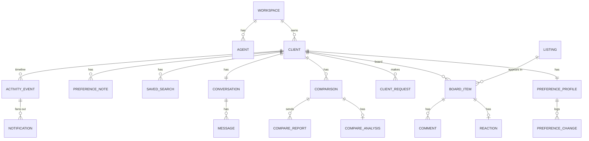

# RealtorHelper — Implementation Requirements

| | |
|---|---|
| Version | 3.0 |
| Date | 2026-10-03 |
| Owner | Oleksandr Martyniuk |
| Status | Ready for review |
| Sources | HTML prototype (`prototype/realtorhelper.html`), Product & UX spec (Claude Docs) |

This document says **what** to build so a team can implement RealtorHelper without the prototype open. It is technology-neutral: it defines behavior, data, rules, contracts and acceptance criteria, not frameworks or libraries. The tech stack is an open question (§16).

**How to read it**

- Requirement IDs (`PR-3`, `BD-10`) are the reference for tickets and tests.
- Priority: **P0** = MVP, **P1** = fast-follow, **Later** = after MVP.
- "Must", "should" and "may" are used in the RFC 2119 sense.
- ✅ marks behavior demonstrated in the HTML prototype. Match it unless this document says otherwise.
- Examples use the demo data: agent **Maya Chen** (solo, Keller Realty), client **Alex Kim**.

**v3.0 — scope narrowed.** After pilot feedback, we cut everything that duplicates a general-purpose real-estate CRM (client pipeline/stage, tours, offers, documents, household/financing details) and kept what's distinctive: AI-assisted search, shared home comparison, and agent–client communication. See §1.1.

---

## Contents

1. Product summary and scope
2. Glossary
3. Roles, permissions and visibility
4. Domain model
5. State machines
6. Core algorithms and business rules
7. Functional requirements
8. AI features
9. Screens and UX requirements
10. Notifications and activity events
11. External integrations (contracts)
12. API contract (technology-neutral)
13. Mock listing data and demo seed
14. Non-functional requirements
15. Analytics events
16. Acceptance test scenarios
17. Open questions
18. Appendix: prototype reference

---

## 1. Product summary and scope

RealtorHelper is a web app for **buyer's agents**. It pairs an **AI-assisted home search** with a **shared comparison workspace** and **client communication**, per client. The agent and client search, react to and discuss homes together, and the agent uses AI to compare shortlisted homes and send the client a report. It deliberately does not manage the client relationship end to end — no pipeline stage, tours, offers or documents — so it stays simple and doesn't compete with the client's existing CRM and transaction tools.

Two apps share one backend and one design system:

| App | User | Form factor |
|---|---|---|
| Agent app | Agent | Desktop-first (1440 px), usable down to 768 px |
| Client portal | Client (buyer) | Mobile-first web (390 px), usable up to desktop |

### 1.1 Product decisions

| Area | Decision |
|---|---|
| Listing data | Mock data behind a `ListingProvider` interface (§11.1). A real MLS/IDX (RESO Web API) feed can replace it without UI changes. Agents can also enter a listing by hand. |
| Client access | Invite-based portal with magic-link / one-time-code login. No passwords for clients. |
| Organization | Solo agents. Every record carries `workspace_id` so teams can be added later. |
| Buyer model | One buyer per client. |
| Client model | Minimal: name, email, phone, plus the structured preference profile that drives search and fit (§4.3), and the client's own free-text "dream home" note. No pipeline stage, household, financing, tags, source or move-date fields — an agent's existing CRM owns that. |
| Paid, agent-only insight | Fit scores, fit breakdowns and AI features are **agent-only** features of the paid agent plan. Clients never see fit scores and never trigger AI. A client sees comparison results only in a **report the agent sends** (§8.3). |
| AI | Two AI features: "Update preferences from a note" (§8.2) and "AI comparison" (§8.3), behind a vendor-neutral model interface with a rule-based fallback. |
| Client preferences | The client can change any unlocked preference; the change **applies immediately** and the agent gets a **review to-do** closed by **Mark as reviewed** (PR-12). Locked fields become **suggestions** the agent approves or declines. |
| Client requests | Every client ask (preference suggestion, comparison report) and every preference update arrives in the conversation as a **card** the agent acts on (MS-5). |
| Searches | A new search starts **from the client's preferences** (a copy) or **from scratch**. |
| Client-scoped actions | Adding listings (Board tab) always happens inside a client. |
| Out of scope | Pipeline/stage tracking, tour scheduling, offers and transaction management, and document storage are not part of this product. |

### 1.2 Scope

| In MVP | Out of MVP |
|---|---|
| Clients (minimal profile), personal info, private notes, invites | Client pipeline / stage, seller workflows |
| Collaborative preferences with locks, suggestions, review to-dos and history | Tour scheduling, showings, route planning (not part of this product) |
| Preferences from typed or dictated notes (AI) | Offers, transaction management, e-signature (not part of this product) |
| Live, fit-ranked results from the client's preferences, almost matches (agent's Board, Worth a look filter — §7.3, BD-1); client-side saved searches (from preferences or from scratch) with alerts and review-first / auto delivery | Document storage (not part of this product) |
| Mock listing provider, add by search / URL / manual | Team and brokerage roles |
| Board, reactions, comments (shared and private), agent picks | Lead-gen and marketing |
| Compare table, front-runner, AI comparison and reports | Native mobile apps |
| Messaging with request cards, unified inbox | Real MLS/IDX feed |

### 1.3 Delivery phases

| Phase | Scope | Exit gate |
|---|---|---|
| 1. MVP core | §7.1–7.4, §8, notifications (in-app + email) | 3 pilot agents with 2+ active clients each for 2 weeks |
| 2. MVP complete | §7.5–7.6 (Messaging, Authentication and settings) | Pilot agents run a full search-to-comparison loop on the app |
| 3. Fast-follow | All P1 items | — |
| 4. Later | Real MLS/IDX, teams, seller clients, native apps | — |

---

## 2. Glossary

| Term | Meaning |
|---|---|
| Workspace | The tenant. One agent in MVP. All data is scoped to it. |
| Client | A buyer the agent works with. Has one portal login. |
| Preference profile | The client's structured wants (§4.3). One per client, versioned. |
| Importance | Per preference: Must-have, Nice-to-have, Don't care, Deal-breaker. |
| Lock | Agent-set flag on a preference. Client edits to a locked field become suggestions. |
| Suggestion | A client's proposed change to a locked preference, waiting for agent approval. |
| Review to-do | The agent's task to look at client preference changes that are already applied; closed by "Mark as reviewed". |
| Request card | A card in the conversation for a client ask or update that needs agent attention (MS-5). |
| Listing | A property from the provider (or manual). Shared across clients. |
| Board | The shared list of homes for one client (like a Compass Collection). |
| Board item | One listing on one client's board, with state, reaction and comments. |
| Reaction | The client's Love / Like / Maybe / Pass on a board item. |
| Agent pick | An agent's highlight on a board item, with an optional shared note. |
| Fit score | 0–100 score of how well a listing matches the client's preferences (§6.1). Agent-only. |
| Saved search | Named search criteria with client notifications and a delivery mode. |
| Search from preferences | A saved search whose filters were copied from the preferences when it was created (§6.2). Later preference changes do not change its filters. |
| Review first / auto | Delivery mode: new matches wait for the agent (review first) or go straight to the client's board (auto). |
| Almost match | A listing that fails exactly one active search filter. |
| Comparison | A side-by-side of 2–4 board items. |
| AI analysis | Model-generated category scores and explanations for a comparison (§8.3). Agent-only. |
| Report | A snapshot of an AI analysis that the agent sends to the client. |
| Activity event | An immutable record of a collaborative action. Drives feeds and notifications. |

---

## 3. Roles, permissions and visibility

### 3.1 Roles

| Role | Description |
|---|---|
| Agent | Owns the workspace. Full access to all of its clients. |
| Client | One buyer. Access only to their own client record through the portal. |
| System | Background jobs (search runs, simulator, digests). Events are attributed to "system". |

### 3.2 Permissions matrix

| Capability | Agent | Client |
|---|---|---|
| Create, archive, delete a client | Yes | No |
| Edit personal info | Yes | Own contact details only |
| View / write private agent notes | Yes | No |
| Edit preferences | Yes | Unlocked fields apply at once (agent review to-do); locked fields become suggestions |
| Lock / unlock a preference | Yes | No |
| Suggest, update or withdraw a change to a locked field | — | Yes |
| Approve / decline suggestions; mark client changes reviewed | Yes | No |
| Update preferences from a note (AI) | Yes (paid) | No |
| Create / edit saved searches, notifications, delivery mode | Yes | Create from preferences, browse |
| Add a listing to the board | Yes (Board tab) | Yes (from search or by link) |
| React Love / Like / Maybe / Pass | No (uses Agent pick) | Yes |
| Comment on a board item | Shared or private | Shared only |
| Change board item state | Yes | No |
| See fit scores and fit breakdowns | Yes | No |
| Compare homes, set front-runner | Yes | Yes (fact table only) |
| Generate AI analysis, send report | Yes (paid) | No |
| Ask for a comparison report; view sent reports | — | Yes |
| Messaging | Yes | Yes |

### 3.3 Authorization rules

- **AUTH-1 (P0).** Every request is authorized server-side. An agent may access only records with their `workspace_id`. A client may access only records with their `client_id`.
- **AUTH-2 (P0).** Agent-only data — agent notes, private comments, internal tags, fit scores and breakdowns, AI analyses (reports excepted), matches waiting for review — must never be serialized in any response or real-time event to a client session. Test this with a contract test per resource.
- **AUTH-3 (P0).** Private data is shown to the agent with a lock icon and an "Only you" label.
- **AUTH-4 (P0).** Private notes and private comments are never sent to an AI model (§8.1).

---

## 4. Domain model

Field types: `id` (opaque string), `ts` (UTC timestamp), `money` (integer; examples are whole dollars — pick one unit and use it everywhere), `enum(...)`. Every table also has `workspace_id`, `created_at`, `updated_at`. "?" = optional.

### 4.1 Entity overview



### 4.2 Entities

**Workspace** — `id`, `name`, `plan` (includes AI entitlement and quota), `branding {logo_url?, accent_color?, invite_message}`.

**Agent (User)** — `id`, `name`, `email` (unique), `phone?`, `license_no?`, `brokerage`, `avatar_url?`, `timezone`, `quiet_hours {start:"21:00", end:"08:00"}`.

**Client**

| Field | Type | Rules |
|---|---|---|
| id | id | |
| first_name, last_name | string | first_name required |
| email, phone | string? | At least one is required to send an invite |
| preferred_contact | enum(email, sms, phone) | |
| portal_status | enum(not_invited, invited, active, revoked) | §5.1 |
| dream_home_text | string? | Client's free text, shown highlighted to the agent |
| last_activity_at | ts | Updated by any client event |
| archived | bool | |

**AgentNote** — `id`, `client_id`, `body`, `pinned:bool`. Agent-only.

**PreferenceProfile** — `id`, `client_id`, `version:int`, `fields` (map of §4.3), `updated_by`, `updated_at`. Every write increments `version`.

**PreferenceChange** — `id`, `profile_id`, `field`, `aspect: enum(value, importance, lock)`, `old_value`, `new_value`, `changed_by`, `source: enum(manual, onboarding, suggestion, note, revert)`, `status: enum(applied, suggested, accepted, declined, withdrawn)`, `note_id?`, `reason?` (client's note on a suggestion), `request_group_id?`, `resolved_at?`, `reviewed_by_agent_at?`. Client changes to unlocked fields are `applied` and stay in the agent's review to-do while `reviewed_by_agent_at` is empty; client changes to locked fields are `suggested`.

**PreferenceNote** — `id`, `client_id`, `author_id`, `text`, `input_mode: enum(typed, dictated)`, `detected_changes: ChangeProposal[]` (§8.2), `applied_change_ids: id[]`, `status: enum(saved_no_changes, applied, cancelled)`.

**ClientRequest** — `id`, `client_id`, `kind: enum(preference_update, preference_suggestion, compare_report)`, `ref` (change group or comparison id), `payload` (note), `created_at`, `status` (derived, MS-5), `message_id` (its card in the conversation).

**SavedSearch**

| Field | Type | Rules |
|---|---|---|
| id, client_id | id | |
| name | string | Default "{First} — preferences" (numbered if more than one) or "New search" |
| origin | enum(preferences, scratch) | §6.2; shown on the tile and in settings |
| criteria | SearchCriteria | Editable |
| alerts | enum(instant, daily, weekly, off) | Client notifications; default daily |
| delivery_mode | enum(curated, auto) | Review first (curated) or straight to the client (auto); default curated |
| hidden_listing_ids | id[] | "Hide from this search" |
| created_by | user id | |
| last_run_at | ts | |

**SearchCriteria** — `price? [min,max]`, `areas? string[]`, `types? string[]`, `beds_min? int`, `baths_min? number`, `commute_max_min? int`, `size_sqft? [min,max]`, `hoa_max? money`, `features? enum(garage, yard, office, primary_main, ...)[]`, `exclude_near_highway: bool`. An absent key means "no filter".

**Listing**

| Field | Type | Notes |
|---|---|---|
| id | id | |
| provider, external_id | string | `provider = manual` for hand-entered |
| status | enum(active, pending, sold, off_market) | |
| address, neighborhood, lat, lng | | |
| price, price_drop | money | `price_drop` = last reduction, 0 if none |
| beds (label), beds_n, baths, sqft, lot_sqft, year_built | | `beds` label may read "3 + den" |
| property_type | enum(single_family, townhouse, condo, multi_family, land) | |
| hoa_monthly, tax_annual | money | |
| days_on_market | int | "New" = ≤ 7 days |
| commute_min | int | Minutes to the client's commute target; a mock/precomputed listing attribute (§6.6) |
| features | {garage: 0/0.5/1, yard: 0/0.5/1, office: 0/0.5/1, primary_main: bool, near_highway: bool, ...} | 1 = full (2-car garage, fenced yard, dedicated office), 0.5 = partial (1-car, small yard, den), 0 = none |
| school_rating | int 1–10 | Data only; never a filter (fair housing) |
| photos | url[] | 6–12 |
| description | text | |
| listing_agent | {name, phone, email}? | |

**BoardItem** — `id`, `client_id`, `listing_id`, `added_by`, `added_via: enum(agent_pick, search_match, client_search, client_link, manual)`, `state` (§5.2), `agent_pick: bool`, `agent_note?` (shared "Why Maya picked it"), `pinned`, unique (`client_id`, `listing_id`).

**Reaction** — `id`, `board_item_id`, `value: enum(love, like, maybe, pass)`, `reasons: enum(price, location, layout, size, condition, commute, hoa)[]` (Pass only). One active reaction per item; choosing the current value clears it.

**Comment** — `id`, `board_item_id | comparison_id`, `author_id`, `body`, `visibility: enum(shared, agent_only)`, `mentions[]`, `attachments[]`. Clients write `shared` only.

**Comparison** — `id`, `client_id`, `name`, `board_item_ids` (2–4, ordered), `front_runner_id?`, `differences_only: bool` (default true).

**CompareAnalysis** — schema in §8.3.6; `inputs_hash`, `status: enum(generating, ready, failed)`, `edited_by?`. Agent-only.

**CompareReport** — immutable snapshot of a ready analysis sent to the client: `id`, `comparison_id`, `analysis` (copy), `sent_by`, `sent_at`, `seen_by_client_at?`. The client sees the latest report.

**Conversation / Message** — one conversation per client. Message: `id`, `conversation_id`, `author_id`, `body?`, `attachments[]`, `card? {type: request | listing | comparison, ref_id}`, `read_by[]`.

**ActivityEvent** — `id`, `client_id`, `actor_id` (or "system"), `type` (§10.1), `payload`, `visibility`. Immutable.

**Notification** — `id`, `recipient_id`, `event_ids[]` (batched), `channel: enum(in_app, email, sms, push)`, `sent_at`, `read_at?`.

### 4.3 Preference fields

Each field has a value, an `importance` (must, nice, off, never) and a `locked` flag. P0 fields are scored by §6.1. P1 fields are captured and shown, and join scoring when added to §6.1.

| Group | Field key | Value type | Control | Default importance | Pri |
|---|---|---|---|---|---|
| Budget | `price` | {min, max} money | Range input | must | P0 |
| Budget | `hoa` | max money / month | Number | nice | P0 |
| Budget | `monthly_payment_max`, `down_payment` | money | Number | off | P1 |
| Location | `areas` | neighborhood[] (P1: polygons, zips) | Chips / map | must | P0 |
| Location | `commute` | minutes to commute target, 10–60, step 5 | Stepper | must | P0 |
| Location | `near_highway` | boolean "avoid near I-94" | Toggle | never | P0 |
| Location | `avoid_areas`, `school_district` | | | off | P1 |
| Property | `type` | property_type[] | Chips | must | P0 |
| Property | `beds` | min, 1–6, step 1 | Stepper | must | P0 |
| Property | `size` | {min, max} sqft | Range | nice | P0 |
| Property | `baths_min`, `lot_min`, `year_built`, `stories`, `new_construction_ok` | | | off | P1 |
| Features | `garage` | "2-car preferred" | Importance only | must | P0 |
| Features | `yard` | "Fenced yard" | Importance only | must | P0 |
| Features | `office` | "A room with a door" | Importance only | must | P0 |
| Features | `primary_main` | "Bedroom on the main floor" | Importance only | nice | P0 |
| Features | `basement`, `guest_room`, `mudroom`, `central_ac`, `fireplace`, `ev_charging`, `pool` | | Importance only | off | P0 capture (onboarding), P1 scoring |
| Condition | `condition` | move_in_ready / light_cosmetic / fixer_ok | Select | off | P1 |
| Lifestyle | `walkability`, `quiet_street`, `near_parks`, `near_transit` | | Importance only | off | P1 |
| Free text | `dream_home_text` | text | Textarea | — | P0 |

Rules:
- **PF-1.** Deal-breaker (`never`) is available only on "avoid" fields (`near_highway`, P1 `avoid_areas`). Other fields offer must / nice / off.
- **PF-2.** Ranges must satisfy min ≤ max. Beds 1–6; commute 10–60 minutes.
- **PF-3.** Protected-class attributes must never be preference fields (fair housing). School ratings are data, not filters.
- **PF-4.** Captured-only fields (not used by search or fit) save directly from onboarding and do not create review to-dos until they are scored.

---

## 5. State machines

Every transition writes an ActivityEvent (§10). Transitions not listed are rejected with `409 invalid_transition`.

### 5.1 Portal invite

`not_invited → invited → active`; `invited → invited` (resend); `invited | active → revoked`. An invite link expires after 7 days; resend issues a new one.

### 5.2 Board item state

`new → shortlisted`, plus `rejected` and `archived` from any state. The agent changes state from a select.
- A client Love suggests Shortlist to the agent (P1 chip). A client Pass does not change state.

### 5.3 Preference suggestion (locked fields)

`suggested → accepted | declined`, or `withdrawn` by the client. One pending suggestion per field; the client can update or withdraw it while pending. Approve applies the value. Decline keeps the value and posts an agent chat message (editable template) ✅ — price: "I'd like to keep the max at $650,000 — we still have strong options in that range. Happy to talk!"; other fields: "I'd like to keep {field} as it is for now — happy to talk it through!"

### 5.4 AI analysis and report

`none → generating → ready | failed`; `ready → generating` (regenerate). A `ready` analysis is **out of date** when the current `inputs_hash` differs (§8.3.4). Sending creates a CompareReport snapshot; regenerating never changes a sent report.

---

## 6. Core algorithms and business rules

Implement these once, server-side, and expose them to both apps. Unit-test each with the fixtures in §13.3.

### 6.1 Fit score (0–100) ✅

Weights: must = 3, nice = 1, off = 0. For each scored preference *i* with weight *wᵢ* > 0, compute a match *mᵢ* ∈ {0, 0.5, 1}:

| Preference | m = 1 | m = 0.5 | m = 0 |
|---|---|---|---|
| price | min ≤ price ≤ max | 0.9·min ≤ price ≤ 1.1·max | otherwise |
| areas | neighborhood in areas | neighborhood adjacent to a preferred area | otherwise |
| commute | commute ≤ limit | commute ≤ 1.1·limit | otherwise |
| beds | beds_n ≥ min | beds_n = min − 1 | otherwise |
| type | property_type in types | — | otherwise |
| garage / yard / office | feature = 1 | feature = 0.5 | 0 |
| size | min ≤ sqft ≤ max | sqft ≥ 0.9·min | otherwise |
| primary_main | true | — | false |
| hoa | hoa ≤ cap | — | otherwise |

```
Fit = round(100 × Σ wᵢ·mᵢ / Σ wᵢ)
```

- **FS-1.** If any must-have has m = 0, cap the score at 69.
- **FS-2.** If `near_highway` is a deal-breaker and the listing is near the highway, Fit = 0 and the UI shows "Deal-breaker". The listing can still be added.
- **FS-3.** Σ wᵢ = 0 → Fit = 0 with a "No preferences weighted" note.
- **FS-4.** Bands: ≥ 80 great (accent color), 60–79 good, < 60 weak.
- **FS-5.** The fit breakdown lists each weighted preference with ✓ (1), ≈ (0.5) or ✗ (0), its importance, and a detail line (e.g. "22 min drive", "3 + den bd — wants 4+").
- **FS-6.** Fit recalculates whenever preferences or listing data change.
- **FS-7.** Fit is agent-only. The client portal never shows a fit number, pill, band or breakdown; it may use fit to order results without showing it.
- Adjacency (demo metro): Linden Hills ↔ Oak Park, Hillcrest ↔ Cedar Grove, Downtown ↔ Riverside.

### 6.2 Creating a search ✅

| Option | Initial criteria |
|---|---|
| **Agent's live results (§7.3, Board → Worth a look)** | Not a separate object — the Board's Worth a look filter always reflects the client's *current* preferences directly: must-haves become filters (price range, areas, types, beds min, commute max, size range, HOA max, required features), deal-breakers become exclusions (e.g., near I-94), nice-to-haves rank results through the fit score, don't-care is ignored. Every preference edit re-ranks the results at once; there is nothing to create or snapshot. |
| **Client's saved search — from preferences** | A snapshot of the preferences at creation time: same mapping as above, but frozen (SC-1). |
| **Client's saved search — from scratch** | No filters; all active listings ranked by fit. |

- **SC-1.** A client-created "from preferences" search is a snapshot. Later preference changes re-rank its results but do not change its filters.
- **SC-2.** A client may have several searches of either origin. The portal's "Search with your preferences" opens the client's existing from-preferences search if there is one, else creates it.

### 6.3 Search execution ✅

1. Start from all `active` listings.
2. Apply active filters in this order: price, areas, types, beds, commute, size, HOA, features, highway.
3. Results = listings passing all filters, minus hidden ones, sorted by fit (desc).
4. **Almost matches** = listings failing exactly one active filter, sorted by fit, each with the reason (e.g. "$25k over max price", "31 min commute", "No office"), plus the filter that causes the most: "Relaxing '{filter}' would add N".
5. **New matches** = results not on the board, listed ≤ 7 days ago, not hidden.

### 6.4 Match delivery ✅

- **Review first:** new matches wait in the agent's queue ("{N} new matches listed in the last 7 days — Alex sees them once you send them"). The agent sends all, adds one, or hides one.
- **Send straight to the client:** new matches go to the client's board as `new`, `added_via = search_match`. Switching a search to this mode immediately sends its current new matches.
- **Client notifications:** instant = on each run with new results; daily / weekly = digest at 8 am client local time; off = none.

### 6.5 Payment estimate ✅

Demo formula: `monthly = price × 0.8 × 0.00632 + price × 0.011 / 12 + hoa` (20% down, ~6.5% 30-year P&I, 1.1% annual tax, plus HOA). Production: principal + interest + tax + HOA + insurance from a configurable down payment and rate (default 6.5%, 30-year fixed). Always labeled "Estimate".

### 6.6 Commute time

The client has no stored address. `commute_min` is a per-listing mock attribute seeded with the rest of the listing data (§13.1), standing in for drive time to the client's (out-of-app) commute target. Production may replace it with a routing API behind the same `ListingProvider` contract (§11.1), without changing the preference model or fit score.

### 6.7 Batching and inactivity

- Several reactions by the same client within 10 minutes batch into one notification ("Alex loved 3 homes").
- A client with no activity for 7 days raises "{Name} has been inactive for N days" in Needs attention.

---

## 7. Functional requirements

Acceptance criteria (AC) use Given / When / Then. Every screen has empty, loading and error states (UX-1).

### 7.1 Clients and dashboard

| ID | Requirement | Pri |
|---|---|---|
| CL-1 | Agent creates a client. Only first name is required. Optional: last name, email, phone, "Send portal invite now" (default on) with a message preview. | P0 |
| CL-2 | Client list: table with name + email, budget, areas, last activity, loved count; text filter by name or area ✅. | P0 |
| CL-3 | Client page header: avatar, name, portal status, **Message**. Tabs: Overview, Preferences, Board, Compare, Messages. Tab indicators: Preferences = pending suggestions + unreviewed changes, else "N new" matches; Board = item count; Messages = "N open" requests, else unread count ✅. | P0 |
| CL-4 | Overview: search progress (homes on board, loved, shortlisted), activity timeline (latest 7), personal info, private notes ✅. | P0 |
| CL-5 | Private notes: add, list newest first, pin (P1). Labeled "Only you" ✅. | P0 |
| CL-6 | Invite by email and/or SMS, resend, revoke; portal status shown. | P0 |
| CL-7 | Archive / restore; export client data as CSV. | P1 |
| CL-8 | Import clients from CSV. | P1 |
| DB-1 | **Needs attention** feed, live ✅. Items, each with a deep-link action: review to-do for client preference changes ("To do: review Alex's preference changes (N)", latest two changes and time — Review); pending suggestions ("Alex suggested a change to Price range" — Review); new search matches with the top fit (Review); new loves (Open board); unseen client comments (Reply); homes added by the client (View); unread messages (Reply); inactive clients. Items clear when acted on or seen. | P0 |
| DB-2 | Home header: greeting, date and "N things need your attention" ✅. | P0 |
| DB-3 | Stat tiles (active clients, new matches this week, homes on board, comparisons sent) ✅. | P0 |
| DB-4 | The notification bell shows the Needs-attention count ✅. | P0 |
| DB-5 | Listings are added from the client's Board tab (BD-4); Home and the top bar have no such shortcut ✅. | P0 |

**AC — DB-1**
- Given Alex loved 1248 Linden Ave, when Maya opens Home, then Needs attention shows "Alex loved 1248 Linden Ave" with Open board; opening the board clears it.
- Given Alex commented on a home, when Maya opens that listing, then the "Alex commented on…" item disappears.

### 7.2 Preferences & search

This tab is **preferences only**, on both sides, and reads as the same screen for the agent and the client: a review-to-do banner when there's something of the other party's to look at (PR-12), the minimal **AI Voice** button at the top (PR-9/PR-13), then the four groups as a **one-at-a-time accordion** (PR-1) — no results, ever. It was a merged preferences+results screen in two earlier builds (first with a card grid, then with a results list under the accordion); results were dropped entirely from this tab both times results were tried, so the screen now reads as what it is: the place to set preferences and collaborate, nothing else.

Live, fit-ranked results (§6.2/§6.3) still exist — every preference edit still re-ranks them at once — but they surface only on the agent's **Board**, under the **Worth a look** filter (BD-1), alongside the board's existing Loved / To review / Shortlisted / Passed views. The client never sees them directly; Alex finds out what matched only downstream, once Maya (or a sent match) puts a home on the board.

| ID | Requirement | Pri |
|---|---|---|
| PR-1 | Fields grouped Budget, Location, Property, Features, shown as a **one-at-a-time accordion** on both the agent's and the client's screens ✅: a closed category is one row — icon, title, a one-line summary of its current values ("$550,000 – $650,000 · $250 / mo max", or "Open to anything" if nothing is set) — and a dot if one of its fields has a pending suggestion or change. Tapping a closed category opens it in place and closes whichever category was open; there's no secondary per-field toggle. What's inside an open category differs by role (PR-2): the agent sees every field's full control at once (value editor, importance chip, lock toggle); the client taps a field to open its edit sheet. Agent-only hint: "Importance drives the fit score on every listing." | P0 |
| PR-2 | Editing ✅. Agent: inline controls and steppers (bedrooms ±1 within 1–6, commute ±5 within 10–60) inside the expanded row; changes apply at once. Client: tap a field to open an edit sheet with its control (price min/max, HOA max, area chips, commute select, home-type chips, bedrooms select, size min/max) and an importance selector (Must-have / Nice-to-have / Don't care; avoid fields: Deal-breaker / Don't care); quick steppers and the importance chip also work on unlocked rows. Client changes to unlocked fields apply immediately ("Saved — Maya was notified") and go to the agent's review to-do (PR-12). Validation: min ≤ max ("Min must be below max"); areas and types need at least one. | P0 |
| PR-3 | Locks and suggestions ✅. The agent can lock any field; the expanded row reads "Locked by you — Alex's edits become suggestions". The client row reads "Set with Maya · tap to suggest a change"; its sheet says "Maya locked this one. Your change goes to her as a suggestion." with an optional "Why?" and **Send suggestion to Maya**. While pending, the collapsed row carries a dot and the expanded row shows the suggestion with **Approve** / **Decline** inline; reopening on the client's side offers **Update suggestion** and **Withdraw suggestion**. | P0 |
| PR-4 | The agent approves or declines a suggestion from the field row itself (PR-3), from a card in Messages, or from Needs attention ✅. Decline sends the decline message (§5.3). The client sees "N suggestions waiting for Maya", then "Maya approved your change to …" or "Maya kept … as it was". | P0 |
| PR-5 | Change history: who, what (`Bedrooms 3+ → 4+`, `Garage → Nice-to-have`, `Locked Price range`), when. Recorded for every edit, suggestion and onboarding change; not surfaced on the Preferences tab in this build (kept deliberately lean) — a future build may expose it in a drawer. Revert a change (P1). | P1 |
| PR-6 | Client onboarding wizard (6 steps, progress bar, Skip, resume later): Budget → Areas → Home type & size → Must-haves → Deal-breakers → Dream home. Must-haves step: chips — tap once = nice, twice = must, third = off ✅. Answers stay a draft until **Continue**, which applies them (unlocked fields) and adds each change to the review to-do ✅. | P0 |
| PR-7 | A changed or suggested field carries a dot ✅: on the agent's side, on the field itself once its category is open, and on the closed category's row so it's visible without opening it; on the client's side, on the affected category's row and on the Preferences tab itself (PR-14). | P0 |
| PR-8 | Dream-home text captured in onboarding (§4.2) and available to the agent; not displayed on the Preferences tab in this build. | P1 |
| PR-9 | **Update from a note** (AI): a single, clearly AI- and voice-branded **AI Voice** button by default — minimal, no card chrome. Tapping it starts speech-to-text directly (§8.2); a small "or type" link reveals the text field without starting voice. Once there's a draft, the full card (field, live preview, Clear / Save) expands in place and collapses again after Save or Clear. Detected changes show live; nothing is saved until the agent approves them in a review dialog (§8.2). | P0 |
| PR-10 | Saved notes on the card: quote, time, "N changes applied" or "No preference changes" ✅. | P0 |
| PR-11 | Any preference change recalculates fit scores and the live results on the Board's Worth a look filter (BD-1) at once, and notifies the other party. | P0 |
| PR-12 | **Review to-do for client changes** ✅. Every applied client change (edit sheet, stepper, importance chip, onboarding) joins one open review to-do, shown as: (a) a to-do banner on the tab — "To do: review N changes Alex made — they're already applied to Alex's preferences and fit scores" — listing each change old → new with its time, and **Mark as reviewed**; (b) a dot on the changed field's row; (c) a Needs-attention item; (d) a "To review" card in Messages collecting all changes, with Open preferences and Mark as reviewed; (e) the tab's badge and a notification. Mark as reviewed (from any place) closes it everywhere; the card turns "Reviewed" and the client's copy reads "Reviewed by Maya". The next change starts a new to-do and card. | P0 |
| PR-13 | **Client-side "Update from a note" (AI)** ✅. The same minimal **AI Voice** button (PR-9) on the client's Preferences screen; tapping starts speech-to-text, "or type" reveals the field without starting voice, and a live preview of detected changes expands in place. Unlike the agent's flow, there is no separate review dialog: on **Save**, each detected change is routed through the client's existing per-field rules — unlocked fields **apply immediately** and join the agent's review to-do (PR-12), locked fields become **suggestions** (PR-3), grouped under one suggestion group quoting the note so the agent approves or declines them together. A toast summarizes what happened ("Updated Commute · sent Price range to Maya as a suggestion"). No new agent-side approval step is introduced; client actions still only ever reach data through the existing lock/suggestion model (AI-3). | P0 |
| PR-14 | **Client-only addition to PR-1's shared accordion** ✅: the Preferences tab itself carries the same dot as an affected category, so a pending suggestion is visible without opening the screen at all. | P0 |
| SS-7 | **Agent only, on the Board's Worth a look filter (BD-1), not the Preferences tab** ✅ — the client's Preferences screen never shows results, a map, or a fit score; matches reach Alex only through the Board. "Homes matching {client}'s preferences, not yet on the board — ranked by fit", then a horizontal row per home, one per line (thumbnail, price, price-cut badge, New badge, beds/baths/sqft/type, address, commute, fit pill, **Add**) — not a card grid, and not paginated. | P0 |
| SS-8 | Map view for Worth a look: matches as filled pins (a dot inside = on board), almost matches as hollow pins, other listings as grey dots, neighborhood labels, legend with counts; clicking a pin opens the listing. The engine (§6.3) supports this; not surfaced as a Board view in this build (List only), kept deliberately lean — a later build may add a List/Map toggle to Worth a look the way the old Preferences-tab results once had one. | P1 |
| SS-9 | Almost matches (up to 6 rows with the failing reason and "Add anyway"; header "N homes miss exactly one filter · relaxing '{filter}' would add N"). The engine (§6.3) still computes these; not surfaced on Worth a look in this build, kept deliberately lean. | P1 |
| SS-10 | **Removed from the client portal.** The client's screen (Preferences, C4, §9.3) carries no results, no map, no fit score and no "Save to my board" from a live list — only the AI Voice note (PR-13) and the accordion of preferences (PR-1). Alex still adds homes to the board directly (BD-11, by URL or by hand) or receives ones Maya picks; a live, self-browsed match list is no longer part of the client experience, by design (§7.2). | — |
| SS-11 | Draw an area on the map (polygon), agent only. | P1 |
| SS-12 | Multiple named saved searches with per-search alerts and review-first / auto delivery (§6.4) remain a data-model capability (SavedSearch, §4.2) but are not surfaced as UI chrome anywhere in MVP — the agent's Board works off the client's current preferences directly (PR-1…PR-14, SS-7…SS-9), and the client has no results view to attach a saved search to. | Later |

**AC — PR-3 / PR-4**
- Given Price range is locked at $550k–$650k, when Alex sets Max $700,000 with a note and sends it, then Maya sees a dot on the Price range row, and expanding it shows the suggestion with Decline / Approve; history shows "Suggested Price range: $550,000 – $650,000 → $550,000 – $700,000".
- When Maya approves, then max becomes $700,000, fit scores recalculate, and Alex sees "Maya approved your change to price range."
- When Maya declines, then the value stays and Alex gets the decline message in chat.

**AC — PR-12**
- Given Areas is unlocked, when Alex adds Linden Hills and saves, then Areas changes at once, fit scores recalculate, and Maya sees the banner line "Areas: Oak Park, Cedar Grove, Westgate → Oak Park, Cedar Grove, Westgate, Linden Hills", a dot on the Areas row, the Needs-attention item and the "To review" card.
- When Alex then changes the commute with the stepper, the same to-do and card gain a second line.
- When Maya clicks Mark as reviewed, the banner, dots and Needs-attention item disappear, the card reads "Reviewed", and Alex's card reads "Reviewed by Maya".

### 7.3 Listings and board

| ID | Requirement | Pri |
|---|---|---|
| BD-1 | Agent board: filter chips with counts (All, Loved, To review, **Worth a look**, Shortlisted, Passed), sort (Best fit, Lowest price, Newest), **Add listing**, card grid ✅. **Worth a look** ✅ folds the live, fit-ranked search results (not on the board yet, §6.2/§6.3) into the board itself, as a row list (not the card grid) with an **Add** button per row — this is where the agent now finds and reacts to new matches, replacing the results list that used to sit on the Preferences tab (§7.2). List and map views for the rest of the board remain P1. | P0 |
| BD-2 | Agent card: photo, select checkbox, "Agent pick", "Added by Alex", fit pill, price, state badge, beds/baths/sqft, address, reaction line ("Alex · Loved"), comment count; passed cards dimmed ✅. | P0 |
| BD-3 | Multi-select bar: "N homes selected", Compare (2–4), Clear ✅. | P0 |
| BD-4 | **Add listing** (Board tab only) opens "Add a listing to {client}'s board": new matches from the client's searches first (with "Open search"), else best-fit active listings, each with fit pill and **Add as pick**; paste a URL (resolved by the provider; "not recognized" → manual entry) or enter a home by hand ✅. | P0 |
| BD-5 | Client reactions Love / Like / Maybe / Pass on cards and detail; choosing the current one clears it. Pass opens "What didn't work?" chips: Price, Location, Layout, Size, Condition, Commute, HOA. Reacting to a home not on the board adds it as "Added by you" ✅. | P0 |
| BD-6 | Agent pick toggle and shared note ("Why Maya picked it") ✅. | P0 |
| BD-7 | Agent listing detail ✅: gallery, price, status, est. monthly, address, days listed, facts (beds, baths, sqft, lot, year, HOA, $/sqft), **Why it fits Alex** (fit number, "Meets X of Y must-haves", breakdown per FS-5, Edit preferences), description, the client's reaction and pass reasons (read-only), board state select, Agent pick toggle, Add to board, comments. | P0 |
| BD-8 | Client listing detail ✅: hero with share and photo count, price, "Maya's pick", address, est. monthly, facts, reaction bar with pass reasons, "Why Maya picked it", comments, description; sticky action **Compare** (max 4). | P0 |
| BD-9 | Comments: shared by default; the agent can switch a comment to "Only you" (dashed, lock) ✅. @mentions and photo attachments P1. | P0 |
| BD-10 | Provider status and price changes show on cards and notify (pending, sold, price cut). | P0 |
| BD-11 | Client board ✅: title with counts, preferences shortcut, agent chip, filters (To review, Loved, All, Passed), cards with reaction bar and Maya's note (no fit score), and a banner: "Maya sent you a comparison report". | P0 |
| BD-12 | Swipe mode for "To review". | P1 |

### 7.4 Compare

| ID | Requirement | Pri |
|---|---|---|
| CP-1 | Pick 2–4 homes: agent multi-select on the board; client "Compare" on a listing (max 4) ✅. | P0 |
| CP-2 | Page layout ✅. Agent: header "Top N — {name}", "Alex sees this table. The AI report reaches Alex only when you send it.", Differences only, **Send report to Alex**; the AI card (§8.3); then the full-width comparison table. Client: title, "Shared with Maya", Differences toggle, the latest report (if any), "Ask Maya for a comparison report" (MS-8), then the table. | P0 |
| CP-3 | Table rows grouped: **Cost** (price, $/sqft, est. monthly, HOA) · **Home** (beds, baths, size, lot, year) · **Fit & location** (commute, school rating, and for the agent only must-haves met and fit score; the client group is "Location") · **Alex's take** (reaction) ✅. | P0 |
| CP-4 | Best value per row in bold with a check; "Differences only" (default on) hides equal rows ✅. | P0 |
| CP-5 | Front-runner (client: "Top pick") set by either party; the agent can remove a home; comments on the comparison ✅. | P0 |
| CP-6 | AI comparison: per-category scores with explanations for each home (§8.3) ✅. | P0 |
| CP-7 | AI summary, overall scores, recommendation, trade-off and "Worth checking" (§8.3) ✅. | P0 |
| CP-8 | The AI analysis is agent-only. The client sees only reports the agent sends ✅. | P0 |
| CP-9 | Report delivery ✅: sending posts a chat message ("I sent you a comparison report for 3 homes. 1248 Linden Ave comes out on top — the details are in Compare."), a client board banner and a dot on the client's Compare tab until opened. The agent header then shows "Report sent {time}"; after a regenerate, **Send updated report**. | P0 |
| CP-10 | Out-of-date detection and one-click Regenerate (§8.3.4) ✅. | P0 |
| CP-11 | Entitlement: generating requires an active paid agent plan and counts against its AI quota (§14); otherwise an upgrade prompt shows and the fact table still works. | P0 |
| CP-12 | The agent can edit an explanation or add their own take; labeled "Edited by Maya". | P1 |
| CP-13 | Export or share the comparison as PDF. | P1 |

### 7.5 Messaging and client requests

| ID | Requirement | Pri |
|---|---|---|
| MS-1 | One conversation per client: bubbles with author and relative time, composer ✅. | P0 |
| MS-2 | Share a listing or comparison as a rich card. | P0 |
| MS-3 | Agent inbox ✅: conversation list with last message (a request shows as "Request: {title}"), unread dot and "N requests" badge; the thread opens with the open-requests list (MS-6), then the conversation; "Open client". | P0 |
| MS-4 | Unread counts on tabs and navigation; the client's Messages tab shows "N open" while requests are open ✅. | P0 |
| MS-5 | **Request cards** ✅. Every client ask or update is posted to the conversation as a card, counted as unread, and handled from the card. The client sees the same card with live status ("Waiting for Maya", "Maya was notified", "Reviewed by Maya", "Approved", "Report sent"). Kinds below. | P0 |
| MS-6 | The agent's Messages tab and inbox thread start with **Open requests from {client} · N** (title, status, time, action buttons). Resolved cards stay in the thread, greyed ✅. | P0 |
| MS-7 | Open requests also appear in Needs attention (DB-1) and notify per §10 ✅. | P0 |
| MS-8 | The client's Compare shows "Ask Maya for a comparison report" (or "…an updated report") when no sent report covers the current homes, and "Report requested — Maya will send it soon" while one is open ✅. | P0 |
| MS-9 | Read receipts, typing indicator, attachments. | P1 |
| MS-10 | Reply templates on each card (e.g., "Approved — I'll update your search"). | P1 |

| Card | Client trigger | Card shows | Agent actions | Resolved when |
|---|---|---|---|---|
| Preferences changed (to review) | Any applied change (PR-12) | All changes since the last review, old → new | Open preferences, Mark as reviewed | Marked as reviewed |
| Suggestion | Edit on a locked field (PR-3) | The change old → new, note | Approve, Decline | Approved or declined |
| Comparison report | "Ask Maya for a comparison report" (MS-8) | The compared homes | Open Compare | A report is sent after the request |

### 7.6 Authentication and settings

| ID | Requirement | Pri |
|---|---|---|
| AU-1 | Agent sign-up / sign-in with email + password; Google SSO; forgot password. | P0 |
| AU-2 | Client magic link or 6-digit code (email or SMS); code valid 10 minutes, 5 attempts, resend after 30 s. | P0 |
| AU-3 | Sessions: agent 30 days sliding; client 90 days sliding; revoked with the portal. | P0 |
| AU-4 | 2FA for agents. | P1 |
| SE-1 | Settings: profile, branding (logo, color, invite message), notification preferences per event and channel, quiet hours. | P0 |
| SE-2 | Billing and plan (AI entitlement). | P1 |

---

## 8. AI features

### 8.1 Shared principles

- **AI-1. Vendor-neutral.** All model calls go through one internal interface.

```ts
interface LlmProvider {
  // Returns JSON that satisfies `schema`, or throws LlmError.
  generateStructured<T>(req: {
    task: 'preferences_from_note' | 'compare_analysis';
    system: string;          // versioned prompt
    input: unknown;          // redacted, task-specific payload
    schema: JsonSchema;      // output contract
    maxOutputTokens: number;
    timeoutMs: number;
  }): Promise<{ output: T; model: string; latencyMs: number; usage?: { in: number; out: number } }>;
}
```

- **AI-2. Human in the loop.** AI output never changes data or reaches the client without an explicit agent action (Approve & save, Send report).
- **AI-3. Agent-only generation; client note-parsing is the exception.** Only agents trigger a `generateStructured` call (compare analysis, or a note reviewed in the agent's dialog, §8.2). The client's own "Update from a note" (PR-13) runs the same `preferences_from_note` task, but its output never needs a human-in-the-loop dialog of its own — it is applied through the existing, already-gated preference rules (apply if unlocked, suggest if locked, PR-2/PR-3), so AI-2 is satisfied by that mechanism instead.
- **AI-4. Grounded.** Numbers, homes and preferences in output must match the input; a server-side validator checks this before anything is shown.
- **AI-5. Fallback.** If the model fails, times out, or fails validation twice, use the deterministic rules engine (the prototype logic) and label the result "Generated by rules".
- **AI-6. Privacy.** Send only what the task needs. Never send private notes, private comments, contact details or financing amounts beyond the price range. Log prompts and outputs without PII for 30 days for quality review.
- **AI-7. Fair housing.** Prompts forbid statements about demographics, safety, crime, "family-friendly" or similar steering; validators reject outputs containing deny-listed terms.
- **AI-8. Versioning.** Store `prompt_version`, `model` and `schema_version` with every result.
- **AI-9. Evaluation.** Keep a golden set per task (§8.4) and run it in CI on any prompt or model change.

### 8.2 Update preferences from a note (PR-9, PR-13) ✅

**Goal.** The agent types or dictates what the client said ("They can stretch the budget to $675k now; an office is a must, a garage would be nice") and approves the detected changes in one step.

#### 8.2.1 UX

1. Card "Update from a note" on the Preferences tab, tagged **AI**: "Tap AI Voice and tell me what Alex said, or type below. Either way, you approve every change before it's saved."; a prominent **AI Voice** button; textarea; Clear; **Save** (disabled when empty); "Try an example" when empty.
2. **AI Voice** starts speech-to-text (§11.4) directly — no separate record step. While listening the button reads "Listening… tap to stop", the field is highlighted, and the transcript streams into the textarea (appended, editable). Unsupported or blocked: "Voice input isn't supported in this browser — type instead" / "Microphone access is blocked — type instead".
3. **Live preview** (debounced 500 ms): "N changes detected" with chips (`Price range: $550,000 – $675,000`, `Garage → Nice-to-have`), or "Nothing detected yet" with the hint "Mention price, areas, home type, bedrooms, size, commute, HOA, the highway, or features like garage, yard and office."
4. **Save**: with no changes, store the note (`saved_no_changes`) — "Note saved — no preference changes found"; otherwise open the review dialog.
5. **Review dialog** "Review changes to Alex's preferences": the note as a quote; "N changes found in your note. Untick anything you don't want to save."; one checked row per change with label (+ "· importance"), old struck through → **new**, and for locked fields "Locked by you — saving overrides the lock"; "What happens when you save": "Fit scores change on X of Y homes on Alex's board" and "Alex sees the new preferences in the portal. Each change is logged in Change history."; Cancel (keeps the draft) / **Approve & save N changes** (disabled when none ticked).
6. On approve: apply ticked changes atomically, write one PreferenceChange each (`source = note`), store the note with its applied count, log "updated N preferences from a note", clear the draft, "Saved N changes — fit scores recalculated", notify the client.

#### 8.2.2 Contract

Input:

```json
{
  "note": "string (≤ 2,000 chars)",
  "current_preferences": { "price": {"min":550000,"max":650000,"importance":"must","locked":true}, "...": {} },
  "vocab": { "areas": ["Oak Park","Cedar Grove","Westgate","Linden Hills","Riverside","Hillcrest","Downtown"],
             "types": ["Single-family","Townhouse","Condo"] }
}
```

Output (`ChangeProposal[]`):

```ts
interface ChangeProposal {
  field: 'price'|'hoa'|'areas'|'commute'|'near_highway'|'type'|'beds'|'size'|'garage'|'yard'|'office'|'primary_main';
  aspect: 'value' | 'importance';
  new_value: unknown;          // the field's value shape, or the importance enum
  evidence: string;            // exact quote from the note
  confidence: number;          // 0–1; < 0.5 shown unticked with "Check this"
}
```

Validation: the field exists; values in range (beds 1–6, commute 10–60, price 100k–5M, min ≤ max); areas and types from the vocabulary; `evidence` is a substring of the note; the proposal differs from the current value. Invalid proposals are dropped and logged.

#### 8.2.3 Mapping rules (also the rules fallback) ✅

| Signal in the note | Result |
|---|---|
| "under / up to / max / stretch to / budget of $675k" | price.max = 675,000 |
| "at least / from / over $500k" | price.min |
| "between 500 and 600k", "500–600k" | price min and max |
| Bare number in price context (< 5,000) | × 1,000 ("650" → $650,000) |
| "no HOA" / "HOA under $300" | hoa = 0 / 300 |
| "at least 2,000 sq ft", "2000–2800 sqft" | size min / range |
| "commute up to 35 minutes" | commute = 35 (clamped 10–60) |
| "3 bedrooms", "four beds", "3br" | beds = 3 (clamped 1–6) |
| "add Linden Hills", "open to Riverside" | add area |
| "drop / not / avoid / stay away from Westgate", "Westgate is out" | remove area |
| "only Oak Park and Westgate" | areas = exactly those |
| "townhouses are fine", "no condos", "only single-family" | add / remove / set types |
| "highway is fine / don't mind the highway" | near_highway → off; "avoid the highway" → never |
| "office is a must / need / has to / essential / want" | importance must |
| "would be nice / prefer / ideally / bonus / a plus" | importance nice |
| "doesn't matter / don't care / not essential / optional / flexible" | importance off |
| Feature mentioned with no modifier | nice, only if currently off |
| List sharing one modifier ("garage, yard and office are must-haves") | the modifier applies to all |
| "too / also / as well" | inherits the previous clause's modifier |

Word numbers (one–sixty) are normalized; commas inside numbers ("2,000") are not clause breaks.

**AC — PR-9**
- Given the note "Talked to Alex today. They can stretch the budget to $675k now. A home office is a must, a garage would be nice but not essential. Add Linden Hills and drop Westgate. A commute up to 35 minutes is fine, and 3 bedrooms would work.", when Maya presses Save, the dialog lists exactly 5 changes: Price range → $550,000 – $675,000 (locked warning); Areas → Oak Park, Cedar Grove, Linden Hills; Commute ≤ 30 → ≤ 35 min; Bedrooms 4+ → 3+; Garage Must-have → Nice-to-have.
- Unticking Bedrooms and approving applies 4 changes; the saved note reads "4 changes applied".
- A note with nothing mappable is saved with "No preference changes" and no dialog.
- Cancel leaves preferences and the draft unchanged.

#### 8.2.4 Client variant (PR-13) ✅

The client's Preferences screen (C4) carries its own **AI Voice** button, the same progressive-disclosure UX as 8.2.1 steps 1–3 (voice or type, live preview of detected changes) and the same parsing (8.2.2, 8.2.3) — there is no separate client-facing contract or mapping table. It diverges from 8.2.1 only from the point of saving:

- There is no review dialog. **Save** applies each detected change directly through the existing per-field rule (PR-2/PR-3): unlocked fields apply at once and add to the agent's review to-do (PR-12); locked fields become suggestions, grouped under one suggestion group that quotes the note, so the agent sees and resolves them together as usual (PR-4).
- The note itself is not stored as a separate object the way the agent's is (PR-10) — its only trace is the review-to-do / suggestion entries it produced, each tagged "From a note" with the quoted text.
- A toast confirms the outcome ("Updated Commute · sent Price range to Maya as a suggestion"); a note with nothing mappable toasts "Got it — nothing to change there" and saves nothing.

This keeps AI-2 satisfied without adding a client-facing approval step: the gate is the lock, not a dialog.

### 8.3 AI comparison (CP-6 … CP-10) ✅

#### 8.3.1 Output

For 2–4 homes:
- per home and category (Budget, Location, Property, Features): a 0–10 score (one decimal) and a 1–3 sentence explanation citing listing facts and the client's preferences;
- per home: overall score, must-haves met, pros, cons;
- a summary (≤ 90 words): the recommended home and why, how the others compare, and the trade-off between the top two ("If space matters more to Alex than features, 4410 Cedar Grove Ln is the better pick.");
- **Worth checking**: 3–5 things to verify before making an offer or asking the listing agent.

#### 8.3.2 Categories

| Category | Preferences scored | Explanation covers |
|---|---|---|
| Budget | price, hoa (P1: monthly payment) | Price vs range and headroom, cheapest / priciest in the set, est. monthly, HOA vs cap |
| Location | areas, commute, near_highway (P1: lifestyle) | Preferred / adjacent area, commute vs limit and shortest in set, deal-breakers, school rating as context (not scored) |
| Property | type, beds, size (P1: condition, baths, lot) | Type match, beds vs target (a den may count), sqft vs range, largest in set |
| Features | garage, yard, office, primary_main (+ P1 extras) | What it has, partial matches (1-car garage, den as office), missing must-haves |

A category with no weighted preferences shows "Not scored": "Alex marked everything here as 'Don't care', so it isn't scored."

#### 8.3.3 Scoring

1. **Rubric score** per category = 10 × (Σ w·m / Σ w) over its weighted preferences (§6.1).
2. **Adjustment δ** from client signals (shared comments, reactions, pass reasons): each signal fragment maps to one category and moves it ±0.5; |δ| ≤ 1 per category. Examples: "Love the backyard and the office nook." → Features +0.5; "Commute might be a stretch" → Location −0.5. Questions ("Is the street busy at rush hour?") never adjust a score; they go to Worth checking.
3. Category score = clamp(rubric + δ, 0, 10).
4. Deal-breaker: Location = 0 and Overall = 0, labeled "Deal-breaker".
5. Overall = Σ(w_c × s_c) / Σ w_c, where w_c = sum of importance weights in category c.
6. The model writes explanations, pros/cons, summary and checks and may propose δ with the quoted signal; it may not change rubric scores. The validator enforces |score − rubric| ≤ 1 and that every δ quotes a real client comment.

#### 8.3.4 Lifecycle

- `inputs_hash` = hash of the ordered compared listing ids, the full preference profile, and per home the client comment count and reaction.
- Generated automatically the first time a comparison with ≥ 2 homes is opened; afterwards only on **Regenerate**.
- When the hash differs: "Out of date — Preferences, the compared homes or Alex's feedback changed since this analysis. Regenerate to update the scores."; Regenerate becomes the primary button.
- A sent report is a snapshot; after regenerating, the agent sees "Send updated report".
- One generation per comparison at a time; a second request returns the in-flight job.

#### 8.3.5 UX

**Agent (above the table)**
- Card with an "AI comparison" tag, title "How these homes fit Alex's preferences", meta "Generated 2 min ago · 3 homes · 12 weighted preferences · only you until you send it / sent to Alex 5 min ago / Alex has an earlier version", Regenerate.
- Loading: skeleton lines, "Analyzing 3 homes against Alex's preferences and comments…" (aria-busy).
- Summary panel.
- Score grid: columns = homes in rank order (address, price, neighborhood, "Best fit" or "Deal-breaker"); rows = Overall ("Weighted by importance", "7 of 8 must-haves met") then each category (row header "2 must-haves, 1 nice-to-have"). Cell: score (accent ≥ 8, muted < 5), bar, explanation, adjustment tag "+0.5 from Alex's comment: '…'".
- Worth checking list.
- Footnote: "AI-generated from listing data, Alex's preferences and Alex's comments. Each score starts from the fit rubric; the model can move a category by up to ±1 and says why. Private notes are never used."

**Client (above the table, when a report was sent)**
- Card "AI comparison · Report from Maya · {time}", the summary, then one block per home in rank order: address, price, "Best fit", overall score, and per category label, bar, score and explanation.

#### 8.3.6 Output schema

```ts
interface CompareAnalysis {
  comparison_id: string;
  inputs_hash: string;
  generated_at: string;              // ISO
  generator: 'llm' | 'rules';
  model?: string; prompt_version: string; schema_version: string;
  edited_by?: string;
  rank: string[];                    // listing ids, best first
  homes: {
    listing_id: string;
    overall: number;                 // 0–10, 1 decimal
    musts_met: [number, number];     // e.g. [7, 8]
    deal_breaker: boolean;
    categories: {
      key: 'budget' | 'location' | 'property' | 'features';
      score: number | null;          // null = not scored
      rubric_score: number | null;
      adjustment?: { delta: number; signal: 'comment' | 'reaction' | 'pass_reason'; quote?: string };
      explanation: string;           // 1–3 sentences
      facts: string[];               // e.g. ["listing.commute", "prefs.commute"]
    }[];
    pros: string[];                  // e.g. "the lowest price", "the shortest commute"
    cons: string[];                  // e.g. "a 31-min commute (limit 30)"
  }[];
  summary: string;                   // ≤ 90 words
  checks: string[];                  // 3–5
}
```

#### 8.3.7 Model input (redacted)

Per home: address, neighborhood, price, est. monthly, HOA, beds label and count, baths, sqft, type, feature values, near-highway flag, commute minutes, school rating, days on market, and the client's shared comments, reaction and pass reasons. Plus the preference profile with importances, the rubric scores, and "best in set" facts (lowest price, shortest commute, most space, best-rated schools). Never private comments, agent notes, contact info.

#### 8.3.8 Worth-checking rules (fallback and guidance)

| Trigger | Check text |
|---|---|
| Client comment ending in "?" | "Alex asked about {address}: '{question}' Check it with the listing agent." |
| commute m = 0.5 | "Confirm the commute from {address} at rush hour (listed {n} min, limit {limit})." |
| office m = 0.5 | "Confirm the den at {address} closes off as an office." |
| garage m = 0.5 | "Check whether the 1-car garage at {address} is enough for Alex." |
| beds m = 0.5 | "See if {address} has space for a {n}th bedroom." |
| price m = 0.5 | "Ask how firm the {price} price is at {address}." |
| areas m = 0.5 | "Walk {neighborhood} with Alex; it borders a preferred area." |

**AC — CP-6…CP-10** (demo seed; 1248 Linden Ave, 4410 Cedar Grove Ln, 17 Westgate Ct)
- Opening Compare shows the loading state, then Linden (9.3) > Cedar Grove (8.6) > Westgate (8.5) with the rules engine; the summary names Linden as the strongest match with "7 of 8 must-haves".
- Cedar Grove Location shows 7.0 with "−0.5 from Alex's comment: 'Commute might be a stretch'".
- Before sending, Alex's Compare has no AI card and no fit rows; after Send report to Alex, it shows the report, and Alex gets a chat message and a board banner.
- Removing a home or changing a preference shows "Out of date"; Regenerate clears it, Alex keeps the earlier report, and the agent sees "Send updated report".
- An output saying "$640,000" for a $629,000 home is rejected by the validator.

### 8.4 Evaluation

| Task | Golden set | Pass criteria |
|---|---|---|
| Preferences from note | ≥ 60 notes (typed and transcribed, messy phrasing, negations, lists, numbers in words) with expected proposals | Precision ≥ 0.95, recall ≥ 0.85; no changes to fields not mentioned |
| AI comparison | ≥ 20 comparisons (2–4 homes, deal-breakers, ties, missing data) | 100% schema-valid and grounded; |δ| rule never violated; fair-housing deny-list 0 hits; human usefulness rating ≥ 4/5 for 90% |

Latency: note parse p95 < 3 s; comparison p95 < 8 s. One call per save / per generation, cached by `inputs_hash`.

---

## 9. Screens and UX requirements

### 9.1 Global UX rules

- **UX-1.** Every data view has loading (skeleton), empty (with a primary action) and error (retry) states.
- **UX-2.** Actions give feedback with a toast (bottom center, max 3, 2.8 s).
- **UX-3.** Private content always shows a lock and "Only you".
- **UX-4.** Reactions, comments, messages, requests and preference changes appear for the other party within 2 s without refresh.
- **UX-5.** Light theme by default, with a Light / Dark switch; the choice is remembered per user ✅.
- **UX-6.** WCAG 2.2 AA: keyboard access for all actions (card selection, menus, compare table), visible focus, reactions not by color alone, aria-live toasts, dialogs and menus close on Escape, dialogs trap focus.
- **UX-7.** Responsive: the agent sidebar collapses to a top nav under 860 px; the client portal goes full-bleed under 520 px.
- **UX-8.** Relative times: "just now", "N min ago", "N h ago", "Yesterday", "N days ago".
- **UX-9.** Money as "$629,000"; compact "$629k" in dense places.

### 9.2 Agent app

Layout: left sidebar (Home, Clients, Inbox, Listings; Settings; the agent's card) and top bar (global search, notifications bell with count, avatar).

| # | Screen | Key content | Requirements |
|---|---|---|---|
| A1 | Sign in / up | Email + password, Google | AU-1 |
| A2 | Home | Greeting, date and attention count; stat tiles; Needs attention | DB-1…DB-5 |
| A3 | Clients table | Filter, table | CL-2 |
| A4 | New client modal | | CL-1 |
| A5 | Client Overview | Header and tabs; progress stats, activity, personal info, private notes | CL-3…CL-5 |
| A6 | Client Preferences | Review to-do banner; a single minimal **AI Voice** button at the top (expands only once there's a note to review); then the four groups (Budget, Location, Property, Features) as a **one-at-a-time accordion** — a closed category shows an icon and a one-line summary, opening one closes whichever was open and reveals its fields and controls directly (no further per-field toggle). No results on this screen — matches surface on the Board's **Worth a look** filter (A7, BD-1) instead. | PR-* |
| A6a | Review changes dialog | | §8.2.1 |
| A7 | Client Board | Filters (All, Loved, To review, **Worth a look**, Shortlisted, Passed), sort, Add listing, cards, selection bar | BD-1…BD-4 |
| A8 | Add listing modal | | BD-4 |
| A9 | Listing detail | | BD-7, BD-9 |
| A10 | Compare | Header, AI card, comparison table | CP-* |
| A11 | Client Messages / Inbox | Open requests list, cards with actions, conversation | MS-* |
| A12 | Settings | | SE-1 |

### 9.3 Client portal

Bottom tabs: Board, Preferences, Compare, Chat. Dots: Chat (unread), Compare (unseen report), Preferences (a suggestion pending with Maya). The header shows the agent chip (tap → Chat).

| # | Screen | Key content | Requirements |
|---|---|---|---|
| C1 | Invite landing | Agent photo, brokerage, message, Get started, "Already joined? Go to your board"; expired state | CL-6 |
| C2 | Sign-in | Email/phone → 6-digit code | AU-2 |
| C3 | Onboarding wizard | 6 steps | PR-6 |
| C4 | Preferences | No results, map or fit score — preferences only (SS-10). Four categories (Budget, Location, Property, Features) as a **one-at-a-time accordion** (PR-1): a closed category shows an icon, title and a one-line summary of its values, with a dot if a suggestion on it is pending; opening one closes whichever was open, revealing its fields ("Tap to edit" / "Set with Maya · tap to suggest a change" / "Suggestion sent: …", quick steppers and importance chips on unlocked fields). A minimal **AI Voice** button expands to live preview, Clear / Save. "Changes save right away and Maya is notified. Locked items go to her as suggestions." | PR-1…PR-3, PR-13, PR-14 |
| C4a | Edit preference sheet | Control, importance; unlocked: Save; locked: Why?, Send / Update suggestion, Withdraw; Cancel | PR-2, PR-3 |
| C5 | Board | | BD-11 |
| C6 | Listing detail | | BD-8 |
| C6a | Pass reasons sheet | | BD-5 |
| C7 | Compare | Report, Ask Maya for a report, fact table, Top pick | CP-2…CP-5, MS-8 |
| C8 | Chat | Messages and the client's request cards with status | MS-1, MS-5 |
| C9 | Notifications + settings | | §10 |

### 9.4 Design system components

ListingCard (S/M/L), FitPill and FitScoreBadge (agent only), ReactionBar, PreferenceField (collapsed one-line row that expands in place), ImportanceChip (Must-have filled, Nice-to-have soft, Don't care dashed, Deal-breaker outlined with ×), Stepper, LockToggle, AiVoiceButton, StatusPill, VisibilityTag, PopupMenu, SearchMap, CompareTable, AiComparisonCard, ScoreBar, RequestCard, TodoBanner, ActivityItem, ChatBubble + RichCard, Sheet (mobile), Modal, Toast, Skeleton, EmptyState. Tokens: color (incl. accent and accent-soft), type scale, 4-pt spacing, radius, elevation; light and dark.

---

## 10. Notifications and activity events

### 10.1 Event catalogue

| Event type | Actor | Recipient | Default channels | Needs attention |
|---|---|---|---|---|
| `invite.accepted` | Client | Agent | In-app, email | Yes |
| `prefs.changed` | Either | Other party | In-app, email digest; client changes join the review to-do and card | Client change: yes, until reviewed |
| `prefs.reviewed` | Agent | Client | Card shows "Reviewed by Maya" | — |
| `prefs.note_applied` | Agent | Client | In-app | — |
| `request.created` (suggestion, comparison report) | Client | Agent | In-app, email; request card | Yes, until resolved |
| `request.resolved` | Agent | Client | In-app, email; the card updates | — |
| `search.created` | Either | Other party | In-app | — |
| `search.matches_new` (auto) | System | Client | Per notification setting | — |
| `search.matches_review` (review first) | System | Agent | In-app, daily email | Yes |
| `board.added` | Either | Other party | In-app, push (P1) | Client add: yes |
| `board.reaction` | Client | Agent | In-app (batched) | Love: yes |
| `board.comment` / mention | Either | Other party / mentioned | In-app, email, push (P1) | Yes |
| `listing.status_changed` / `price_cut` | System | Agent + client | In-app, email | Yes if shortlisted |
| `compare.report_sent` | Agent | Client | In-app, email, chat message | — |
| `compare.front_runner` | Either | Other party | In-app | — |
| `message.new` | Either | Other party | In-app; email if unread 15 min | Unread: yes |
| `client.inactive` | System | Agent | In-app | Yes |

### 10.2 Rules

- **NT-1.** Every event writes an ActivityEvent and feeds the client timeline (agent sees all; client sees shared events only).
- **NT-2.** Channel preferences per user, event type and channel (SE-1).
- **NT-3.** Batching per §6.7.
- **NT-4.** Quiet hours (default 21:00–08:00 local) delay push and SMS, not in-app or email.
- **NT-5.** Every email has a per-category unsubscribe link.
- **NT-6.** Notification center: list, unread state, mark read, deep link.

---

## 11. External integrations (contracts)

### 11.1 ListingProvider

```ts
interface ListingProvider {
  search(criteria: SearchCriteria, page: { cursor?: string; limit: number }): Promise<{ items: Listing[]; next?: string }>;
  getById(externalId: string): Promise<Listing | null>;
  resolveUrl(url: string): Promise<Listing | null>;   // paste-a-link; null → "not recognized"
  changesSince(ts: Date): Promise<ListingChange[]>;    // status and price updates
}
```

MVP ships `MockListingProvider` (§13). `resolveUrl` accepts URLs containing `/listing/<id>` or seeded fake portal URLs.

### 11.2 Email

Transactional sender with templates: invite, magic code, digest, notification, report sent. Per-category unsubscribe.

### 11.3 SMS

Invites and magic codes only. Opt-out keywords honored.

### 11.4 Speech-to-text

Browser speech recognition where available (en-US, continuous, interim results); optional server STT behind an interface. Audio is never stored; only the edited transcript is saved.

### 11.5 Maps

Map tiles and geocoding behind an interface; a stylized map is acceptable for MVP.

### 11.6 File storage

Signed upload and download URLs (15-minute expiry), virus scan on upload, max 20 MB, for message/comment attachments (P1). PDF/JPG/PNG/HEIC.

### 11.7 LLM

`LlmProvider` per §8.1.

---

## 12. API contract (technology-neutral)

Resource-oriented, JSON, versioned (`/v1`). Style (REST, RPC or GraphQL) is a stack decision; the operations below are required.

### 12.1 Conventions

- The auth token identifies the user and role; every response is filtered by §3.3.
- Errors: `{ "error": { "code": "...", "message": "...", "details": {} } }` with codes `unauthorized`, `forbidden`, `not_found`, `validation_failed`, `invalid_transition`, `conflict`, `rate_limited`, `ai_unavailable`, `entitlement_required`.
- Lists: cursor pagination (`limit` ≤ 100).
- Writes accept an `Idempotency-Key`.
- Preference writes carry `version`; a mismatch returns `409 conflict` with the current profile.

### 12.2 Operations

| Resource | Operations |
|---|---|
| Auth | agent sign-up / sign-in / SSO / reset; client request code; client verify code; sign-out |
| Clients | list (text, archived), create, get, update, archive/restore, invite (send/resend/revoke), activity timeline |
| Notes | list, create, pin (agent) |
| Preferences | get profile; patch fields (value / importance / lock) with `version` (client patches to locked fields are rejected); history; revert (P1); suggestions: create / update / withdraw (client), approve / decline (agent); review to-do: list unreviewed client changes, mark reviewed (agent) |
| Preference notes | parse (preview) → ChangeProposal[]; save (note + selected proposals) → applied changes; list |
| Client requests | list for a client with derived status; create comparison-report request (client); other kinds are created by their own operations |
| Searches | list, create (`origin: preferences` copies criteria, or `scratch`), update (name, criteria, alerts, delivery mode), delete; run → {results, almost_matches, new_matches}; hide listing; send matches to board |
| Listings | search, get, resolve URL, create manual |
| Board | list (filters, sort), add, update (state, agent pick, note), remove; set/clear reaction (+ reasons); comments list/create |
| Comparisons | list, create, update (items, front-runner, differences_only), comments |
| Compare analysis | agent: get (with `stale`), generate/regenerate (async job, entitlement check), edit (P1), send report; client: get latest report, mark seen |
| Messages | list conversations, list messages, send, mark read |
| Notifications | list, mark read, get/put settings |

### 12.3 Real-time events

Pushed to sessions of the same `client_id`, filtered by visibility: `board.updated`, `reaction.changed`, `comment.created`, `prefs.updated`, `review.updated`, `suggestion.changed`, `request.changed`, `search.updated`, `compare.updated`, `analysis.updated`, `report.sent`, `message.created`, `notification.created`.

---

## 13. Mock listing data and demo seed

### 13.1 Mock provider data

- One fictional metro. Seed neighborhoods: Oak Park, Cedar Grove, Westgate, Linden Hills, Riverside, Hillcrest, Downtown (an 8th is open, §17). Production mock: ~500 listings.
- Prices $250k–$1.8M; 1–6 beds; 600–5,000 sqft; ~60% single-family, 25% condo, 15% townhouse; Downtown and Riverside skew condo/townhouse.
- Deterministic generation from a fixed seed so tests are stable (prototype: 54 generated + 8 hand-written, seed 20260925).
- Condos: garage 0 or 0.5, yard 0, lot 0, HOA $260–$500. Townhouses: HOA $0 or $120.
- About 16% have a recent price cut (~3%). About 4% (50% in Hillcrest) are near the highway.
- Each listing's `commute_min` is seeded alongside its other attributes (§6.6).
- Photos: licensed stock set, 6–12 per listing. Descriptions generated from features.
- Daily market simulator: adds 5–10 listings, cuts prices on 3%, moves 2% to pending and 1% of pending to sold.

### 13.2 Demo seed

**Agent:** Maya Chen, Keller Realty. **Client:** Alex Kim, alex.kim@email.com, (555) 214-8890; portal active.

**Preferences:** price $550k–$650k must, locked; HOA ≤ $250 nice; areas Oak Park, Cedar Grove, Westgate must; commute ≤ 30 min must; near I-94 deal-breaker; types Single-family, Townhouse must; beds 4+ must; size 1,700–2,600 sqft nice; garage, yard, office must; primary on main nice. Onboarding extras: basement nice, central A/C must, EV charging nice, others off. Dream home: "A quiet street where our daughter can bike, a real office, and a yard big enough for the dog. We don't need fancy — just not a project."

**Open items:** a price suggestion (Price range → $550,000 – $700,000, "The Hillcrest homes are just above our range.", 16 min ago) with its card; a review to-do (Bedrooms 3+ → 4+, 3 days ago) with its "To review" card.

**Hand-written listings**

| # | Address | Hood | Price | Beds | Baths | Sqft | HOA | Commute | School | Type | Garage/Yard/Office | Primary main | Near I-94 | Board state | Reaction |
|---|---|---|---|---|---|---|---|---|---|---|---|---|---|---|---|
| 1 | 1248 Linden Ave | Oak Park | $629,000 | 3 + den | 2.5 | 1,920 | 0 | 22 | 8 | SF | 1/1/1 | No | No | Shortlisted, agent pick | Love |
| 2 | 4410 Cedar Grove Ln | Cedar Grove | $612,500 | 4 | 3 | 2,340 | 45 | 31 | 7 | SF | 1/1/0.5 | No | No | Shortlisted | Like |
| 3 | 17 Westgate Ct | Westgate | $598,000 | 3 | 2 | 1,780 | 0 | 18 | 9 | SF | 0.5/1/0.5 | Yes | No | New | Love |
| 4 | 3021 Maple St | Linden Hills | $579,000 | 3 | 2 | 1,650 | 0 | 24 | 7 | SF | 1/1/0.5 | No | No | New, agent pick | — |
| 5 | 88 Riverside Dr #4B | Riverside | $545,000 | 2 | 2 | 1,310 | 380 | 15 | 6 | Condo | 0.5/0/0 | Yes | No | New | Maybe |
| 6 | 902 Hillcrest Rd | Hillcrest | $675,000 | 4 | 3 | 2,600 | 0 | 34 | 8 | SF | 1/1/1 | Yes | Yes | Rejected | Pass (Price, Location) |
| 7 | 56 Orchard Ln | Oak Park | $641,000 | 4 | 2.5 | 2,210 | 0 | 20 | 8 | SF | 1/1/1 | No | No | Not on board (listed 1 day ago) | — |
| 8 | 2210 Birch Way | Westgate | $589,000 | 3 | 2.5 | 1,840 | 0 | 19 | 9 | Townhouse | 1/0.5/1 | No | No | Not on board (listed 1 day ago) | — |

**Comments:** #1 Alex "Love the backyard and the office nook. Is the street busy at rush hour?"; Maya "It's a cul-de-sac side street — very little through traffic."; Maya (only you) "Seller motivated — relocating in Nov. Room to go $610–615k." · #2 Alex "Commute might be a stretch, but that yard!" · #3 Alex "A primary bedroom on the main floor would be great when my parents visit." · #5 Alex "Nice views but tight for the three of us." · #6 Maya "Backs onto the highway sound wall — flagging since you want to avoid I-94."

**Other seed:**
- Agent note "Very price sensitive above $630k."
- Search "Oak Park houses" (from scratch: $550–650k, Oak Park, Single-family, 3+ beds; daily; send straight to Alex).
- Comparison #1, #2, #3, front-runner #1.
- Messages: Maya "Morning! I added 3021 Maple St — under budget with a big yard. Take a look when you can."; Alex "Will do. What do you think about Westgate?" (unread).

### 13.3 Reference results (demo seed, 62-listing inventory)

| Listing | Fit | Must-haves met |
|---|---|---|
| #1 1248 Linden Ave | 91 | 7 of 8 (beds partial) |
| #2 4410 Cedar Grove Ln | 85 | 6 of 8 |
| #3 17 Westgate Ct | 83 | 5 of 8 |
| #4 3021 Maple St | 78 | 5 of 8 |
| #5 88 Riverside Dr #4B | 26 | 1 of 8 |
| #6 902 Hillcrest Rd | 0 | Deal-breaker |
| #7 56 Orchard Ln | 96 | 8 of 8 |
| #8 2210 Birch Way | 85 | 6 of 8 |

| Check | Expected |
|---|---|
| New search from preferences | 8 results, 12 almost matches |
| New search from scratch | 62 results |
| "Oak Park houses" | 5 results |
| AI overall #1 / #2 / #3 | 9.3 / 8.6 / 8.5 (rules engine) |
| AI Location #2 | 7.0 (rubric 7.5, −0.5) |
| Example note (§8.2 AC) | exactly 5 proposals |

With the 500-listing seed, pin these again with snapshot tests; the hand-written listings' fit scores must not change.

---

## 14. Non-functional requirements

| Area | Requirement |
|---|---|
| Performance | p95 API < 300 ms (non-AI). Board of 200 items renders < 1.5 s on 4G. Search run < 1 s on 500 listings. Note parse p95 < 3 s; comparison p95 < 8 s. |
| Real-time | Cross-party updates < 2 s |
| Availability | 99.5% |
| Security | TLS; encryption at rest; row-level workspace isolation; signed URLs (15 min); audit log for preference and report actions; rate limits on auth (5 code attempts) and AI (plan quota, max 20 generations / agent / hour); OWASP ASVS L1 |
| Privacy | PII limited to contact details. Per-client export and delete (CCPA/GDPR-ready). AI data handling per AI-6. |
| Accessibility | WCAG 2.2 AA (UX-6) |
| Browsers | Latest 2 versions of Chrome, Safari, Edge, Firefox; iOS Safari 16+; Android Chrome |
| Observability | Structured logs, traces, error tracking; AI metrics (latency, failures, fallbacks, validation rejects) |
| i18n | English at launch; strings externalized; currency and units by locale |
| Data retention | Activity and history for the client's lifetime; AI logs 30 days |
| Testability | Deterministic seed; pure, unit-tested rules engines; end-to-end tests for §16 |

---

## 15. Analytics events

Every event carries `workspace_id`, `client_id`, `role`.

| Event | Properties |
|---|---|
| `client_created`, `invite_sent`, `invite_accepted` | channel |
| `onboarding_step_completed`, `onboarding_completed` | step, skipped |
| `pref_changed` | field, aspect, source (manual / note / suggestion / onboarding) |
| `pref_changes_reviewed` | count, minutes_open |
| `pref_note_saved` | input_mode, detected_count, applied_count, unticked_count, generator |
| `suggestion_created`, `suggestion_resolved` | field, outcome |
| `request_created`, `request_resolved` | kind, outcome, minutes_to_resolve |
| `search_created`, `search_mode_changed`, `matches_sent` | origin, mode, count |
| `board_item_added` | added_via |
| `reaction_set` | value, reasons |
| `compare_opened` | homes |
| `ai_analysis_generated` | generator, latency_ms, stale_before, validation_retries |
| `ai_report_sent` | updated, homes |

Pilot success metrics: invite → active ≥ 70%; wizard completion ≥ 60%; ≥ 5 reactions per active client per week; ≥ 60% of board items reacted to within 48 h; agent weekly active ≥ 80%; notes saved with ≥ 1 change applied ≥ 70%; AI reports sent for ≥ 50% of comparisons; client requests resolved and changes reviewed within 24 h ≥ 80%.

---

## 16. Acceptance test scenarios

End-to-end on the demo seed, agent and client sessions side by side.

| # | Scenario | Expected result |
|---|---|---|
| E1 | Agent creates client "Jordan" with invite on; the client opens the link and enters the code | Portal status Invited → Active; the agent gets "accepted invite" |
| E2 | Client completes onboarding, tapping Home office to must | office = must; the agent's review to-do lists the change |
| E3 | Client suggests Max $700k on the locked price; agent approves | Max = $700k; fit scores update; history on both sides |
| E4 | Client edits Areas (unlocked) and the commute stepper | Both apply at once; one review to-do with 2 lines (banner, field tags, Needs attention, card); Mark as reviewed clears it and Alex sees "Reviewed by Maya" |
| E5 | Client portal, every screen | No fit score, pill or breakdown anywhere |
| E6 | Agent saves the example note, unticks Bedrooms, approves | 4 changes applied; saved note "4 changes applied" |
| E7 | Agent opens the Board's Worth a look filter | Results are already ranked by fit from Alex's current preferences (must-have filters and the I-94 exclusion applied) — 8 results, no search to create first, and no results of any kind on the Preferences tab |
| E8 | Agent opens the Budget category and raises the budget, then opens Location | Budget's fields (with full controls) stay visible the whole time it's open, no secondary per-field toggle; opening Location closes Budget, which now shows the new value in its one-line summary; Worth a look's count updates immediately the next time it's opened |
| E9 | Agent clicks Add on a row in Worth a look | The home appears on Alex's board as New, and Worth a look's count drops by one |
| E10 | Client passes on a home with Price, Location | Card dimmed; activity "passed on … — Price, Location" |
| E11 | Agent selects 3 homes → Compare | AI card loads and ranks per §13.3; Alex sees no AI card |
| E12 | Client asks for a report; agent sends it | Card in Messages resolves "Report sent"; Alex gets the chat message, banner and report; the Compare dot clears on open |
| E13 | Agent changes a preference and returns to Compare | "Out of date"; Regenerate updates; Alex keeps the earlier report; "Send updated report" |
| E14 | Client token requests agent notes, private comments, fit scores, the live AI analysis | All 403 / absent |
| E15 | AI provider down | Both AI features work with "Generated by rules" |
| E16 | Client opens Preferences (bottom tab or Board's gear icon), taps AI Voice and dictates/types a note naming one unlocked and one locked field | No review dialog; the unlocked field applies at once and joins the agent's review to-do; the locked field becomes a suggestion quoting the note, grouped for the agent to approve or decline; no results appear anywhere on this screen |
| E17 | On the client's Preferences screen, Alex opens Budget then opens Location | Budget closes the moment Location opens — only one category is ever expanded; the Budget row now shows its one-line summary again |

---

## 17. Open questions

| # | Question | Owner | Needed by |
|---|---|---|---|
| Q1 | Tech stack (frontend, backend, database, hosting). This document is stack-neutral; one option is a TypeScript monorepo with one web app for both portals, a REST + WebSocket API and a relational database with geo support. | Eng lead | Before phase 1 |
| Q2 | LLM vendor and hosting constraints (data residency, retention) | Eng + Legal | Phase 1 |
| Q3 | Product name and brand (RealtorHelper is a working title) | Product | Phase 2 |
| Q4 | Pricing: per-agent subscription with free client seats; AI quota per plan | Business | Phase 2 |
| Q5 | Mock metro: 8th neighborhood, photo set | Design | Phase 1 |
| Q6 | Swipe mode on the client board: P0 or P1 (P1 in this document) | Product | Phase 1 |
| Q7 | Legal review of fair-housing rules for preference fields and AI prompts | Legal | Phase 1 |

---

## 18. Appendix: prototype reference

Reference prototype: `prototype/realtorhelper.html` (single HTML file, vanilla JS, one shared state for both apps). Its prototype-only controls — the view switch (side by side / agent / client), Reset demo, and hint toasts about what the other party sees — are not product features.

| Section | Prototype code |
|---|---|
| §6.1 Fit score | `fitParts`, `fit`, `fitPill` |
| §6.2 Creating a search | `prefCriteria`, `newPrefSearch`, `createPrefSearch` |
| §6.3 Search execution | `FILTERS`, `runSearch`, `newMatches`, `allNewMatches` |
| §6.4 Delivery | (data-model only in this build; not surfaced as UI, SS-12) |
| §7.1 Needs attention | `attention` |
| §7.2 Preferences, suggestions, review to-do | `aSearchPrefs`, `aAccField`, `a-cat-toggle`, `cPrefRow`, `c-cat-toggle`, `cycleImp`, `pref-step`, `c-pref`, `ps-save`, `ps-withdraw`, `sugg`, `resolveSugg`, `sgDesc`, `clientPrefChanged`, `pref-seen`, `ob`, `ob-done`, `cSearch` |
| §7.3 Board, listings and live matches | `aBoard`, `resultRow`, `a-filter` (incl. `matches`), `aListing`, `aAddModal`, `cBoard`, `cListing`, `react`, `add-board` |
| §7.4 Compare | `aCompare`, `cCompare`, `cmpRows`, `cmpTableRows` |
| §7.5 Messaging and request cards | `chatThread`, `aMessages`, `aInbox`, `pushReq`, `reqInfo`, `reqCard`, `reqList`, `openReqs`, `c-ask-report` |
| §8.2 Preferences from a note | `ptParse`, `ptDiff`, `ptPatch`, `ptImpact`, `aPrefsModal`, `ptMic`, `cPtApply`, `c-pt-mic`, `c-pt-open`, `c-pt-save`, `c-pt-clear` |
| §8.3 AI comparison and reports | `aiSignals`, `aiText`, `aiCons`, `aiCompute`, `aiKey`, `aiRun`, `aiCard`, `ai-share`, `cAiCard` |
| §13.2 Demo seed | `BASE`, `INV`, `initState` |

The prototype's rule engines are the reference behavior for the rules fallback (AI-5). Where this document and the prototype differ, this document wins.
