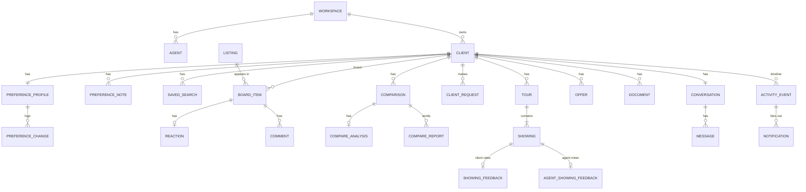
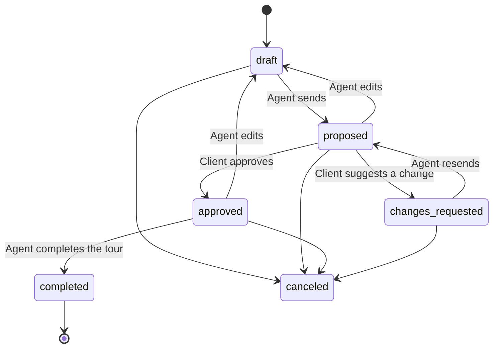
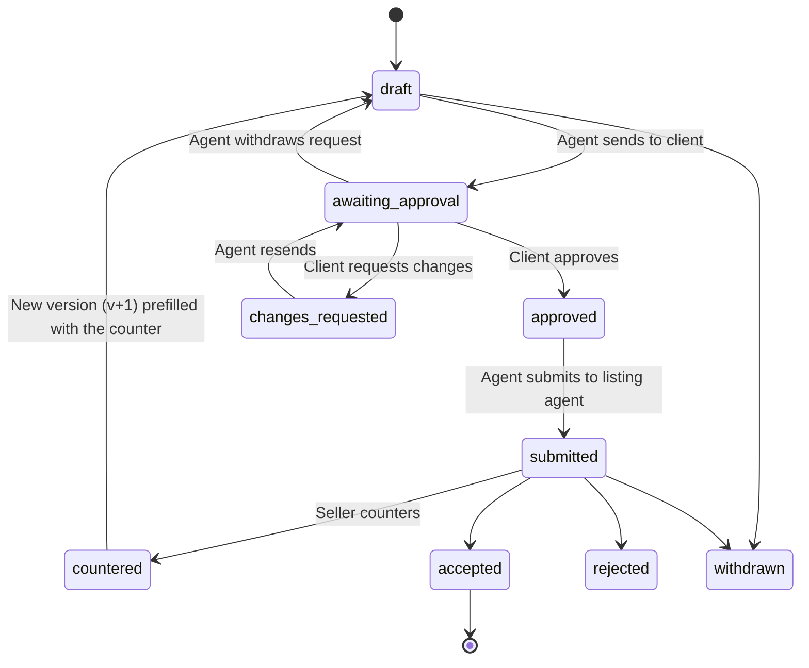

# RealtorHelper — Implementation Requirements

| | |
|---|---|
| Version | 2.0 |
| Date | 2026-09-27 |
| Owner | Oleksandr Martyniuk |
| Status | Ready for review |
| Sources | HTML prototype (`prototype/realtorhelper-v2.html`), Product & UX spec (Claude Docs), Figma file "RealtorHelper" |

This document says **what** to build so a team can implement RealtorHelper without the prototype open. It is technology-neutral: it defines behavior, data, rules, contracts and acceptance criteria, not frameworks or libraries. The tech stack is an open question (§17).

**How to read it**

- Requirement IDs (`PR-3`, `TR-10`) are the reference for tickets and tests.
- Priority: **P0** = MVP, **P1** = fast-follow, **Later** = after MVP.
- "Must", "should" and "may" are used in the RFC 2119 sense.
- ✅ marks behavior demonstrated in the HTML prototype. Match it unless this document says otherwise.
- Examples use the demo data: agent **Maya Chen** (solo, Keller Realty), client **Alex Kim** (first-time buyer).

---

## Contents

1. Product summary and scope
2. Glossary
3. Roles, permissions and visibility
4. Domain model
5. State machines
6. Core algorithms and business rules
7. Functional requirements
8. AI features
9. Screens and UX requirements
10. Notifications and activity events
11. External integrations (contracts)
12. API contract (technology-neutral)
13. Mock listing data and demo seed
14. Non-functional requirements
15. Analytics events
16. Acceptance test scenarios
17. Open questions
18. Appendix: prototype reference

---

## 1. Product summary and scope

RealtorHelper is a web app for **buyer's agents**. It pairs a light client CRM with a **shared home-search workspace per client**. The agent and client work on preferences, saved searches and listings together until the client makes an offer. It is modeled on Compass Collections, with structured preferences and, for the agent, a fit score on every listing.

Two apps share one backend and one design system:

| App | User | Form factor |
|---|---|---|
| Agent app | Agent | Desktop-first (1440 px), usable down to 768 px |
| Client portal | Client (buyer) | Mobile-first web (390 px), usable up to desktop |

### 1.1 Product decisions

| Area | Decision |
|---|---|
| Listing data | Mock data behind a `ListingProvider` interface (§11.1). A real MLS/IDX (RESO Web API) feed can replace it without UI changes. Agents can also enter a listing by hand. |
| Client access | Invite-based portal with magic-link / one-time-code login. No passwords for clients. |
| Organization | Solo agents. Every record carries `workspace_id` so teams can be added later. |
| Buyer model | One buyer per client. |
| Paid, agent-only insight | Fit scores, fit breakdowns and AI features are **agent-only** features of the paid agent plan. Clients never see fit scores and never trigger AI. A client sees comparison results only in a **report the agent sends** (§8.3). |
| AI | Two AI features: "Update preferences from a note" (§8.2) and "AI comparison" (§8.3), behind a vendor-neutral model interface with a rule-based fallback. |
| Client preferences | The client can change any unlocked preference; the change **applies immediately** and the agent gets a **review to-do** closed by **Mark as reviewed** (PR-12). Locked fields become **suggestions** the agent approves or declines. |
| Client requests | Every client ask (showing, tour, comparison report, tour change, offer change, locked-field suggestion) and every preference update arrives in the conversation as a **card** the agent acts on (MS-5). |
| Tours | The agent plans tours on the client's Tours tab. A tour must be **approved by the client** before the agent can complete it. After completion both sides give per-home feedback. Clients can request a tour (day, time, homes). |
| Searches | A new search starts **from the client's preferences** (a copy) or **from scratch**. |
| Client-scoped actions | Adding listings (Board tab) and planning tours (Tours tab) always happen inside a client. |

### 1.2 Scope

| In MVP | Out of MVP |
|---|---|
| Clients and pipeline, personal info, private notes, invites | Seller workflows |
| Collaborative preferences with locks, suggestions, review to-dos and history | Team and brokerage roles |
| Preferences from typed or dictated notes (AI) | Lead-gen and marketing |
| Saved searches (from preferences or from scratch), almost matches, review-first / auto delivery | E-signature (DocuSign) |
| Mock listing provider, add by search / URL / manual | Transaction management after offer acceptance |
| Board, reactions, comments (shared and private), agent picks | Native mobile apps |
| Compare table, front-runner, AI comparison and reports | Real MLS/IDX feed |
| Showing and tour requests, tour planner, route order, client approval, completion, two-sided feedback | |
| Messaging with request cards, unified inbox | |
| Offers with client approval and counter versions, documents | |
| In-app and email notifications, SMS for invites and tour reminders | |

### 1.3 Delivery phases

| Phase | Scope | Exit gate |
|---|---|---|
| 1. MVP core | §7.1–7.6, §8, notifications (in-app + email) | 3 pilot agents with 2+ active clients each for 2 weeks |
| 2. MVP complete | §7.7–7.9, SMS reminders | Pilot agents run a full search-to-offer on the app |
| 3. Fast-follow | All P1 items | — |
| 4. Later | Real MLS/IDX, teams, seller clients, e-signature, native apps | — |

---

## 2. Glossary

| Term | Meaning |
|---|---|
| Workspace | The tenant. One agent in MVP. All data is scoped to it. |
| Client | A buyer the agent works with. Has one portal login. |
| Preference profile | The client's structured wants (§4.3). One per client, versioned. |
| Importance | Per preference: Must-have, Nice-to-have, Don't care, Deal-breaker. |
| Lock | Agent-set flag on a preference. Client edits to a locked field become suggestions. |
| Suggestion | A client's proposed change to a locked preference, waiting for agent approval. |
| Review to-do | The agent's task to look at client preference changes that are already applied; closed by "Mark as reviewed". |
| Request card | A card in the conversation for a client ask or update that needs agent attention (MS-5). |
| Listing | A property from the provider (or manual). Shared across clients. |
| Board | The shared list of homes for one client (like a Compass Collection). |
| Board item | One listing on one client's board, with state, reaction and comments. |
| Reaction | The client's Love / Like / Maybe / Pass on a board item. |
| Agent pick | An agent's highlight on a board item, with an optional shared note. |
| Fit score | 0–100 score of how well a listing matches the client's preferences (§6.1). Agent-only. |
| Saved search | Named search criteria with client notifications and a delivery mode. |
| Search from preferences | A saved search whose filters were copied from the preferences when it was created (§6.2). Later preference changes do not change its filters. |
| Review first / auto | Delivery mode: new matches wait for the agent (review first) or go straight to the client's board (auto). |
| Almost match | A listing that fails exactly one active search filter. |
| Comparison | A side-by-side of 2–4 board items. |
| AI analysis | Model-generated category scores and explanations for a comparison (§8.3). Agent-only. |
| Report | A snapshot of an AI analysis that the agent sends to the client. |
| Tour | A planned showing day with ordered stops. One open tour per client in MVP. |
| Showing | One stop on a tour. |
| Offer | Terms drafted by the agent, approved by the client. Counters are new versions. |
| Activity event | An immutable record of a collaborative action. Drives feeds and notifications. |

---

## 3. Roles, permissions and visibility

### 3.1 Roles

| Role | Description |
|---|---|
| Agent | Owns the workspace. Full access to all of its clients. |
| Client | One buyer. Access only to their own client record through the portal. |
| System | Background jobs (search runs, simulator, digests, reminders). Events are attributed to "system". |

### 3.2 Permissions matrix

| Capability | Agent | Client |
|---|---|---|
| Create, archive, delete a client | Yes | No |
| Edit personal info | Yes | Own contact details only |
| View / write private agent notes | Yes | No |
| Edit preferences | Yes | Unlocked fields apply at once (agent review to-do); locked fields become suggestions |
| Lock / unlock a preference | Yes | No |
| Suggest, update or withdraw a change to a locked field | — | Yes |
| Approve / decline suggestions; mark client changes reviewed | Yes | No |
| Update preferences from a note (AI) | Yes (paid) | No |
| Create / edit saved searches, notifications, delivery mode | Yes | Create from preferences, browse |
| Add a listing to the board | Yes (Board tab) | Yes (from search or by link) |
| React Love / Like / Maybe / Pass | No (uses Agent pick) | Yes |
| Comment on a board item | Shared or private | Shared only |
| Change board item state | Yes | No |
| See fit scores and fit breakdowns | Yes | No |
| Compare homes, set front-runner | Yes | Yes (fact table only) |
| Generate AI analysis, send report | Yes (paid) | No |
| Ask for a comparison report; view sent reports | — | Yes |
| Request a showing or a tour | — | Yes |
| Plan, send, edit, cancel, complete a tour | Yes | No |
| Approve a tour / suggest a change | No | Yes |
| Give per-home tour feedback | Yes (private verdict and notes) | Yes (rating) |
| Draft, send, submit an offer; record seller response | Yes | No |
| Approve an offer / request changes | No | Yes |
| Upload documents | Yes | Yes (e.g., pre-approval) |
| Messaging | Yes | Yes |

### 3.3 Authorization rules

- **AUTH-1 (P0).** Every request is authorized server-side. An agent may access only records with their `workspace_id`. A client may access only records with their `client_id`.
- **AUTH-2 (P0).** Agent-only data — agent notes, private comments, internal tags, fit scores and breakdowns, AI analyses (reports excepted), agent tour feedback, matches waiting for review — must never be serialized in any response or real-time event to a client session. Test this with a contract test per resource.
- **AUTH-3 (P0).** Private data is shown to the agent with a lock icon and an "Only you" label.
- **AUTH-4 (P0).** Private notes, private comments and agent tour feedback are never sent to an AI model (§8.1).

---

## 4. Domain model

Field types: `id` (opaque string), `ts` (UTC timestamp), `money` (integer; examples are whole dollars — pick one unit and use it everywhere), `enum(...)`. Every table also has `workspace_id`, `created_at`, `updated_at`. "?" = optional.

### 4.1 Entity overview



### 4.2 Entities

**Workspace** — `id`, `name`, `plan` (includes AI entitlement and quota), `branding {logo_url?, accent_color?, invite_message}`.

**Agent (User)** — `id`, `name`, `email` (unique), `phone?`, `license_no?`, `brokerage`, `avatar_url?`, `timezone`, `quiet_hours {start:"21:00", end:"08:00"}`.

**Client**

| Field | Type | Rules |
|---|---|---|
| id | id | |
| first_name, last_name | string | first_name required |
| email, phone | string? | At least one is required to send an invite |
| preferred_contact | enum(email, sms, phone) | |
| portal_status | enum(not_invited, invited, active, revoked) | §5.2 |
| stage | enum(lead, onboarding, actively_searching, touring, offer_out, under_contract, closed, paused, lost) | §5.1 |
| source | string? | e.g. "Referral · Mia Wong" |
| tags | string[] | |
| household | {adults:int, children:int, pets:string?} | e.g. 2, 1, "1 dog" |
| current_home | string? | e.g. "Renting downtown, lease ends Dec 31" |
| commute_targets | [{label, address, lat, lng, mode: enum(drive, transit, bike, walk)}] | MVP uses the first one ("Medical Center") |
| target_move_date | date? | |
| financing | {pre_approved:bool, amount:money?, lender:string?, expires_on:date?, down_payment_pct:number?} | |
| dream_home_text | string? | Client's free text, shown highlighted to the agent |
| last_activity_at | ts | Updated by any client event |
| archived | bool | |

**AgentNote** — `id`, `client_id`, `body`, `pinned:bool`. Agent-only.

**PreferenceProfile** — `id`, `client_id`, `version:int`, `fields` (map of §4.3), `updated_by`, `updated_at`. Every write increments `version`.

**PreferenceChange** — `id`, `profile_id`, `field`, `aspect: enum(value, importance, lock)`, `old_value`, `new_value`, `changed_by`, `source: enum(manual, onboarding, suggestion, note, revert)`, `status: enum(applied, suggested, accepted, declined, withdrawn)`, `note_id?`, `reason?` (client's note on a suggestion), `request_group_id?`, `resolved_at?`, `reviewed_by_agent_at?`. Client changes to unlocked fields are `applied` and stay in the agent's review to-do while `reviewed_by_agent_at` is empty; client changes to locked fields are `suggested`.

**PreferenceNote** — `id`, `client_id`, `author_id`, `text`, `input_mode: enum(typed, dictated)`, `detected_changes: ChangeProposal[]` (§8.2), `applied_change_ids: id[]`, `status: enum(saved_no_changes, applied, cancelled)`.

**ClientRequest** — `id`, `client_id`, `kind: enum(preference_update, preference_suggestion, showing, tour_request, compare_report, tour_change, offer_change)`, `ref` (change group, board item, comparison, tour or offer id), `payload` (showing windows; tour request day, start time and homes; compared ids; note), `created_at`, `status` (derived, MS-5), `message_id` (its card in the conversation).

**SavedSearch**

| Field | Type | Rules |
|---|---|---|
| id, client_id | id | |
| name | string | Default "{First} — preferences" (numbered if more than one) or "New search" |
| origin | enum(preferences, scratch) | §6.2; shown on the tile and in settings |
| criteria | SearchCriteria | Editable |
| alerts | enum(instant, daily, weekly, off) | Client notifications; default daily |
| delivery_mode | enum(curated, auto) | Review first (curated) or straight to the client (auto); default curated |
| hidden_listing_ids | id[] | "Hide from this search" |
| created_by | user id | |
| last_run_at | ts | |

**SearchCriteria** — `price? [min,max]`, `areas? string[]`, `types? string[]`, `beds_min? int`, `baths_min? number`, `commute_max_min? int`, `size_sqft? [min,max]`, `hoa_max? money`, `features? enum(garage, yard, office, primary_main, ...)[]`, `exclude_near_highway: bool`. An absent key means "no filter".

**Listing**

| Field | Type | Notes |
|---|---|---|
| id | id | |
| provider, external_id | string | `provider = manual` for hand-entered |
| status | enum(active, pending, sold, off_market) | |
| address, neighborhood, lat, lng | | |
| price, price_drop | money | `price_drop` = last reduction, 0 if none |
| beds (label), beds_n, baths, sqft, lot_sqft, year_built | | `beds` label may read "3 + den" |
| property_type | enum(single_family, townhouse, condo, multi_family, land) | |
| hoa_monthly, tax_annual | money | |
| days_on_market | int | "New" = ≤ 7 days |
| features | {garage: 0/0.5/1, yard: 0/0.5/1, office: 0/0.5/1, primary_main: bool, near_highway: bool, ...} | 1 = full (2-car garage, fenced yard, dedicated office), 0.5 = partial (1-car, small yard, den), 0 = none |
| school_rating | int 1–10 | Data only; never a filter (fair housing) |
| photos | url[] | 6–12 |
| description | text | |
| listing_agent | {name, phone, email}? | |

Commute time is derived per client commute target (§6.7), not stored on the listing.

**BoardItem** — `id`, `client_id`, `listing_id`, `added_by`, `added_via: enum(agent_pick, search_match, client_search, client_link, manual)`, `state` (§5.3), `agent_pick: bool`, `agent_note?` (shared "Why Maya picked it"), `pinned`, unique (`client_id`, `listing_id`).

**Reaction** — `id`, `board_item_id`, `value: enum(love, like, maybe, pass)`, `reasons: enum(price, location, layout, size, condition, commute, hoa)[]` (Pass only). One active reaction per item; choosing the current value clears it.

**Comment** — `id`, `board_item_id | comparison_id`, `author_id`, `body`, `visibility: enum(shared, agent_only)`, `mentions[]`, `attachments[]`. Clients write `shared` only.

**Comparison** — `id`, `client_id`, `name`, `board_item_ids` (2–4, ordered), `front_runner_id?`, `differences_only: bool` (default true).

**CompareAnalysis** — schema in §8.3.6; `inputs_hash`, `status: enum(generating, ready, failed)`, `edited_by?`. Agent-only.

**CompareReport** — immutable snapshot of a ready analysis sent to the client: `id`, `comparison_id`, `analysis` (copy), `sent_by`, `sent_at`, `seen_by_client_at?`. The client sees the latest report.

**ShowingRequest** — `id`, `client_id`, `board_item_id`, `windows: enum(sat_morning, sat_afternoon, sun_afternoon, weekday_evening)[]` (≥ 1), `note?`, `status: enum(open, scheduled, dismissed)`.

**Tour** — `id`, `client_id`, `date`, `start_time` (09:00, 09:30, 10:00, 10:30, 11:00), `start_address` (agent office by default), `status` (§5.5), `optimize_route: bool`, `stop_order: showing_id[]`, `change_note?`, `from_request_id?`.

**Showing** — `id`, `tour_id`, `board_item_id`, `arrive_at`, `duration_min` (default 30), `drive_min_from_prev`, `requested_by_client: bool`, `listing_agent_confirmation: enum(pending, confirmed, declined)`, `access_notes?`.

**ShowingFeedback** (client) — `id`, `showing_id`, `stars: 1–5` (required), `liked: enum(natural_light, kitchen, layout, yard, street, views, storage)[]`, `disliked: enum(too_small, no_yard, hoa, noise, dated, parking, price)[]`, `would_offer: enum(yes, maybe, no)?`, `seen_by_agent: bool`.

**AgentShowingFeedback** — `id`, `showing_id`, `verdict: enum(strong_fit, maybe, not_a_fit)`, `note?`, `updated_at`. Agent-only.

**Offer** — `id`, `client_id`, `board_item_id`, `version:int`, `parent_offer_id?`, `price`, `earnest_money`, `financing` (text, e.g. "Conventional · 20% down"), `contingencies {inspection:bool, inspection_days?, appraisal:bool, financing:bool, financing_days?, sale_of_home:bool}`, `closing_date`, `expires_at`, `note_to_client`, `client_change_request?`, `status` (§5.6), `timeline: [{text, at}]`.

**Document** — `id`, `client_id`, `board_item_id?`, `offer_id?`, `type: enum(pre_approval, disclosure, offer, inspection, other)`, `file_ref`, `uploaded_by`, `visibility: enum(shared, agent_only)`.

**Conversation / Message** — one conversation per client. Message: `id`, `conversation_id`, `author_id`, `body?`, `attachments[]`, `card? {type: request | listing | comparison | tour | offer, ref_id}`, `read_by[]`.

**ActivityEvent** — `id`, `client_id`, `actor_id` (or "system"), `type` (§10.1), `payload`, `visibility`. Immutable.

**Notification** — `id`, `recipient_id`, `event_ids[]` (batched), `channel: enum(in_app, email, sms, push)`, `sent_at`, `read_at?`.

### 4.3 Preference fields

Each field has a value, an `importance` (must, nice, off, never) and a `locked` flag. P0 fields are scored by §6.1. P1 fields are captured and shown, and join scoring when added to §6.1.

| Group | Field key | Value type | Control | Default importance | Pri |
|---|---|---|---|---|---|
| Budget | `price` | {min, max} money | Range input | must | P0 |
| Budget | `hoa` | max money / month | Number | nice | P0 |
| Budget | `monthly_payment_max`, `down_payment` | money | Number | off | P1 |
| Location | `areas` | neighborhood[] (P1: polygons, zips) | Chips / map | must | P0 |
| Location | `commute` | minutes to commute target, 10–60, step 5 | Stepper | must | P0 |
| Location | `near_highway` | boolean "avoid near I-94" | Toggle | never | P0 |
| Location | `avoid_areas`, `school_district` | | | off | P1 |
| Property | `type` | property_type[] | Chips | must | P0 |
| Property | `beds` | min, 1–6, step 1 | Stepper | must | P0 |
| Property | `size` | {min, max} sqft | Range | nice | P0 |
| Property | `baths_min`, `lot_min`, `year_built`, `stories`, `new_construction_ok` | | | off | P1 |
| Features | `garage` | "2-car preferred" | Importance only | must | P0 |
| Features | `yard` | "Fenced yard" | Importance only | must | P0 |
| Features | `office` | "A room with a door" | Importance only | must | P0 |
| Features | `primary_main` | "Bedroom on the main floor" | Importance only | nice | P0 |
| Features | `basement`, `guest_room`, `mudroom`, `central_ac`, `fireplace`, `ev_charging`, `pool` | | Importance only | off | P0 capture (onboarding), P1 scoring |
| Condition | `condition` | move_in_ready / light_cosmetic / fixer_ok | Select | off | P1 |
| Lifestyle | `walkability`, `quiet_street`, `near_parks`, `near_transit` | | Importance only | off | P1 |
| Timing | `must_move_by`, `flexibility` | | | off | P1 |
| Free text | `dream_home_text` | text | Textarea | — | P0 |

Rules:
- **PF-1.** Deal-breaker (`never`) is available only on "avoid" fields (`near_highway`, P1 `avoid_areas`). Other fields offer must / nice / off.
- **PF-2.** Ranges must satisfy min ≤ max. Beds 1–6; commute 10–60 minutes.
- **PF-3.** Protected-class attributes must never be preference fields (fair housing). School ratings are data, not filters.
- **PF-4.** Captured-only fields (not used by search or fit) save directly from onboarding and do not create review to-dos until they are scored.

---

## 5. State machines

Every transition writes an ActivityEvent (§10). Transitions not listed are rejected with `409 invalid_transition`.

### 5.1 Client stage

`lead → onboarding → actively_searching → touring → offer_out → under_contract → closed`, plus `paused` and `lost` from any open stage.

- **ST-1 (P0).** The agent can set any stage manually.
- **ST-2 (P1).** Suggested stage (shown as a chip the agent accepts; derived automatically in the prototype ✅):
  - an offer accepted → `under_contract`
  - an offer awaiting approval, approved or submitted → `offer_out`
  - a tour proposed, approved or completed → `touring`
  - otherwise, once the portal is active → `actively_searching`

### 5.2 Portal invite

`not_invited → invited → active`; `invited → invited` (resend); `invited | active → revoked`. An invite link expires after 7 days; resend issues a new one.

### 5.3 Board item state

`new → shortlisted → touring → offered`, plus `rejected` and `archived` from any state. The agent changes state from a select.
- Sending a tour moves its homes from `new` or `shortlisted` to `touring` ✅.
- An accepted offer moves the item to `offered` ✅.
- A client Love suggests Shortlist to the agent (P1 chip). A client Pass does not change state.

### 5.4 Preference suggestion (locked fields)

`suggested → accepted | declined`, or `withdrawn` by the client. One pending suggestion per field; the client can update or withdraw it while pending. Approve applies the value. Decline keeps the value and posts an agent chat message (editable template) ✅ — price: "I'd like to keep the max at $650,000 — your pre-approval tops out at $650k and we still have strong options. Happy to talk!"; other fields: "I'd like to keep {field} as it is for now — happy to talk it through!"

### 5.5 Tour



- Stops can be edited only in `draft` or `changes_requested` ✅.
- **Complete the tour** is available only in `approved` ✅.
- One open tour (`draft`, `proposed`, `approved`, `changes_requested`) per client ✅ (TR-6).
- `completed` queues a client rating for every stop and opens agent feedback (TR-10).
- Labels — agent: Draft, "Waiting for approval", "Approved by Alex", "Changes requested", Completed, Canceled; client: "Needs your approval", "Approved", "Change sent".

### 5.6 Offer



- A counter creates a new Offer version (`version+1`, `parent_offer_id`), prefilled with the seller's terms, with a diff against the previous version ✅.
- One offer per client may be active at a time. Drafting on another home while one is active is blocked: "Finish the active offer on {address} first" ✅.
- `accepted` moves the client to `under_contract` and the item to `offered` ✅; other open offers are prompted to withdraw.

### 5.7 AI analysis and report

`none → generating → ready | failed`; `ready → generating` (regenerate). A `ready` analysis is **out of date** when the current `inputs_hash` differs (§8.3.4). Sending creates a CompareReport snapshot; regenerating never changes a sent report.

---

## 6. Core algorithms and business rules

Implement these once, server-side, and expose them to both apps. Unit-test each with the fixtures in §13.3.

### 6.1 Fit score (0–100) ✅

Weights: must = 3, nice = 1, off = 0. For each scored preference *i* with weight *wᵢ* > 0, compute a match *mᵢ* ∈ {0, 0.5, 1}:

| Preference | m = 1 | m = 0.5 | m = 0 |
|---|---|---|---|
| price | min ≤ price ≤ max | 0.9·min ≤ price ≤ 1.1·max | otherwise |
| areas | neighborhood in areas | neighborhood adjacent to a preferred area | otherwise |
| commute | commute ≤ limit | commute ≤ 1.1·limit | otherwise |
| beds | beds_n ≥ min | beds_n = min − 1 | otherwise |
| type | property_type in types | — | otherwise |
| garage / yard / office | feature = 1 | feature = 0.5 | 0 |
| size | min ≤ sqft ≤ max | sqft ≥ 0.9·min | otherwise |
| primary_main | true | — | false |
| hoa | hoa ≤ cap | — | otherwise |

```
Fit = round(100 × Σ wᵢ·mᵢ / Σ wᵢ)
```

- **FS-1.** If any must-have has m = 0, cap the score at 69.
- **FS-2.** If `near_highway` is a deal-breaker and the listing is near the highway, Fit = 0 and the UI shows "Deal-breaker". The listing can still be added.
- **FS-3.** Σ wᵢ = 0 → Fit = 0 with a "No preferences weighted" note.
- **FS-4.** Bands: ≥ 80 great (accent color), 60–79 good, < 60 weak.
- **FS-5.** The fit breakdown lists each weighted preference with ✓ (1), ≈ (0.5) or ✗ (0), its importance, and a detail line (e.g. "22 min drive to Medical Center", "3 + den bd — wants 4+").
- **FS-6.** Fit recalculates whenever preferences or listing data change.
- **FS-7.** Fit is agent-only. The client portal never shows a fit number, pill, band or breakdown; it may use fit to order results without showing it.
- Adjacency (demo metro): Linden Hills ↔ Oak Park, Hillcrest ↔ Cedar Grove, Downtown ↔ Riverside.

### 6.2 Creating a search ✅

| Option | Initial criteria |
|---|---|
| **From preferences** | Copied from the current preferences: must-haves become filters (price range, areas, types, beds min, commute max, size range, HOA max, required features); deal-breakers become exclusions (e.g., near I-94); nice-to-haves rank results through the fit score; don't-care is ignored |
| **From scratch** | No filters; all active listings ranked by fit |

- **SC-1.** The copy is a snapshot. Later preference changes re-rank results but do not change the search's filters; the agent edits filters directly.
- **SC-2.** A client may have several searches of either origin. The Preferences tab's "Create search from preferences" and the portal's "Search with your preferences" open the existing from-preferences search if there is one, else create it.

### 6.3 Search execution ✅

1. Start from all `active` listings.
2. Apply active filters in this order: price, areas, types, beds, commute, size, HOA, features, highway.
3. Results = listings passing all filters, minus hidden ones, sorted by fit (desc).
4. **Almost matches** = listings failing exactly one active filter, sorted by fit, each with the reason (e.g. "$25k over max price", "31 min commute", "No office"), plus the filter that causes the most: "Relaxing '{filter}' would add N".
5. **New matches** = results not on the board, listed ≤ 7 days ago, not hidden.

### 6.4 Match delivery ✅

- **Review first:** new matches wait in the agent's queue ("{N} new matches listed in the last 7 days — Alex sees them once you send them"). The agent sends all, adds one, or hides one.
- **Send straight to the client:** new matches go to the client's board as `new`, `added_via = search_match`. Switching a search to this mode immediately sends its current new matches.
- **Client notifications:** instant = on each run with new results; daily / weekly = digest at 8 am client local time; off = none.

### 6.5 Tour timing and route ✅

- Drive time between two stops: `max(6, round(distance_units / 18))` minutes on the demo map; production uses §6.7.
- Each stop lasts 30 minutes. `arrive(stop₁) = start + drive(start, stop₁)`; `arrive(stopₙ) = arrive(stopₙ₋₁) + 30 + drive(stopₙ₋₁, stopₙ)`.
- **Optimize route** (default on): nearest-neighbor from the start address; while on, manual reordering is disabled.
- Summaries show stop count, start–end time and total driving minutes (e.g. "3 homes · 10:00 am – 12:08 pm · 38 min of driving").

### 6.6 Payment estimate ✅

Demo formula: `monthly = price × 0.8 × 0.00632 + price × 0.011 / 12 + hoa` (20% down, ~6.5% 30-year P&I, 1.1% annual tax, plus HOA). Production: principal + interest + tax + HOA + insurance from the client's down payment and a configurable rate (default 6.5%, 30-year fixed). Always labeled "Estimate".

### 6.7 Commute time

Straight-line distance × mode factor: drive 1.4 min/km, transit 2.5, bike 3.5, walk 12. Computed per client commute target, cached per (listing, target). A routing API may replace it.

### 6.8 Batching and inactivity

- Several reactions by the same client within 10 minutes batch into one notification ("Alex loved 3 homes").
- A client with no activity for 7 days raises "{Name} has been inactive for N days" in Needs attention.

---

## 7. Functional requirements

Acceptance criteria (AC) use Given / When / Then. Every screen has empty, loading and error states (UX-1).

### 7.1 Clients and dashboard

| ID | Requirement | Pri |
|---|---|---|
| CL-1 | Agent creates a client. Only first name is required. Optional: last name, email, phone, stage, budget, financing, "Send portal invite now" (default on) with a message preview. | P0 |
| CL-2 | Client list: table with name + email, stage badge, budget, areas, pre-approved, last activity, loved count; stage filter chips with counts; text filter by name or area ✅. | P0 |
| CL-3 | Pipeline view (kanban by stage) with drag to change stage. | P1 |
| CL-4 | Client page header: avatar, name, stage badge, pre-approval, move-by date, portal status, **Message**. Tabs: Overview, Preferences, Searches, Board, Compare, Tours, Messages, Offers (Documents, Activity: P1). Tab indicators: Preferences = pending suggestions + unreviewed changes; Searches = "N new"; Board = item count; Messages = "N open" requests, else unread count ✅. | P0 |
| CL-5 | Overview: search progress (homes on board, loved, shortlisted, toured, offers), activity timeline (latest 7), personal info, private notes, next tour card ✅. | P0 |
| CL-6 | Private notes: add, list newest first, pin (P1). Labeled "Only you" ✅. | P0 |
| CL-7 | Invite by email and/or SMS, resend, revoke; portal status shown. | P0 |
| CL-8 | Manual stage change (P0); suggested stage chip (P1, ST-2). | P0 |
| CL-9 | Archive / restore; export client data as CSV. | P1 |
| CL-10 | Import clients from CSV. | P1 |
| DB-1 | **Needs attention** feed, live ✅. Items, each with a deep-link action: review to-do for client preference changes ("To do: review Alex's preference changes (N)", latest two changes and time — Review); pending suggestions ("Alex suggested a change to Price range" — Review); offer approved by the client (Submit); client requested offer changes (Open offer); "To do: complete the {date} tour after the showings" (Open tour); tour change requested (Edit tour); tour requests ("Alex requested a tour on {day}" — Plan); showing requests (Schedule); "To do: add your feedback for N toured homes" (Add feedback); new search matches with the top fit (Review); new loves (Open board); unseen client comments (Reply); homes added by the client (View); unread messages (Reply); new tour ratings ("Alex rated {address} 4★" — View); offers expiring < 24 h; pre-approval expiring; inactive clients. Items clear when acted on or seen. | P0 |
| DB-2 | Home header: greeting, date and "N things need your attention" ✅. | P0 |
| DB-3 | Upcoming tours (date chip, client, stop count, time range, status) ✅. | P0 |
| DB-4 | Stat tiles (active clients, tours this week, offers out, new matches) and pipeline bars per stage ✅. | P0 |
| DB-5 | The notification bell shows the Needs-attention count ✅. | P0 |
| DB-6 | Listings are added from the client's Board tab (BD-4) and tours are planned on the client's Tours tab (TR-3); Home and the top bar have no such shortcuts ✅. | P0 |

**AC — DB-1**
- Given Alex loved 1248 Linden Ave, when Maya opens Home, then Needs attention shows "Alex loved 1248 Linden Ave" with Open board; opening the board clears it.
- Given Alex commented on a home, when Maya opens that listing, then the "Alex commented on…" item disappears.

### 7.2 Preferences

| ID | Requirement | Pri |
|---|---|---|
| PR-1 | Fields grouped Budget, Location, Property, Features, each with value, importance chip and (agent) lock toggle ✅. Tapping the importance chip cycles must → nice → off (avoid fields: never ↔ off); a full picker is also available. Hint: "Importance drives the fit score on every listing." | P0 |
| PR-2 | Editing ✅. Agent: inline controls and steppers (bedrooms ±1 within 1–6, commute ±5 within 10–60); changes apply at once. Client: tap a field to open an edit sheet with its control (price min/max, HOA max, area chips, commute select, home-type chips, bedrooms select, size min/max) and an importance selector (Must-have / Nice-to-have / Don't care; avoid fields: Deal-breaker / Don't care); quick steppers and the importance chip also work on unlocked rows. Client changes to unlocked fields apply immediately ("Saved — Maya was notified") and go to the agent's review to-do (PR-12). Validation: min ≤ max ("Min must be below max"); areas and types need at least one. | P0 |
| PR-3 | Locks and suggestions ✅. The agent can lock any field; the agent row reads "Locked by you — Alex's edits become suggestions". The client row reads "Set with Maya · tap to suggest a change"; its sheet says "Maya locked this one. Your change goes to her as a suggestion." with an optional "Why?" and **Send suggestion to Maya**. While pending, the row reads "Suggestion sent: {old → new}"; reopening offers **Update suggestion** and **Withdraw suggestion**. | P0 |
| PR-4 | The agent approves or declines a suggestion from a banner on the Preferences tab ("Alex suggested a change to Price range (locked) · $550,000 – $650,000 → $550,000 – $700,000 · '{note}'", Decline / Approve), from its card in Messages, or from Needs attention ✅. The field shows "Suggestion pending". Decline sends the decline message (§5.4). The client sees "N suggestions waiting for Maya", then "Maya approved your change to …" or "Maya kept … as it was". | P0 |
| PR-5 | Change history (latest 7 on the tab, full list in a drawer): who, what (`Bedrooms 3+ → 4+`, `Garage → Nice-to-have`, `Locked Price range`), when ✅. Revert a change (P1). | P0 |
| PR-6 | Client onboarding wizard (7 steps, progress bar, Skip, resume later): Budget → Areas → Home type & size → Must-haves → Deal-breakers → Timing → Dream home. Must-haves step: chips — tap once = nice, twice = must, third = off ✅. Answers stay a draft until **Continue**, which applies them (unlocked fields) and adds each change to the review to-do ✅. | P0 |
| PR-7 | "Create search from preferences" / "Open preferences search" on the Preferences tab (SC-2) ✅. | P0 |
| PR-8 | Dream-home text shown to the agent as "Dream home, in Alex's words" ✅. | P0 |
| PR-9 | **Update from a note** (AI): the agent types or dictates what the client said; detected changes show live; nothing is saved until the agent approves them in a review dialog (§8.2) ✅. | P0 |
| PR-10 | Saved notes on the card: quote, time, "N changes applied" or "No preference changes" ✅. | P0 |
| PR-11 | Any preference change recalculates fit scores and result ranking at once and notifies the other party. Saved search filters do not change (SC-1). | P0 |
| PR-12 | **Review to-do for client changes** ✅. Every applied client change (edit sheet, stepper, importance chip, onboarding) joins one open review to-do, shown as: (a) a to-do banner on the Preferences tab — "To do: review N changes Alex made — they're already applied to Alex's preferences and fit scores" — listing each change old → new with its time, and **Mark as reviewed**; (b) a "Changed by Alex · {time}" tag on each changed field; (c) a Needs-attention item; (d) a "To review" card in Messages collecting all changes, with Open preferences and Mark as reviewed; (e) the Preferences tab count and a notification. Mark as reviewed (from any place) closes it everywhere; the card turns "Reviewed" and the client's copy reads "Reviewed by Maya". The next change starts a new to-do and card. | P0 |

**AC — PR-3 / PR-4**
- Given Price range is locked at $550k–$650k, when Alex sets Max $700,000 with a note and sends it, then Maya sees the suggestion banner and card, the Preferences count includes it, and history shows "Suggested Price range: $550,000 – $650,000 → $550,000 – $700,000".
- When Maya approves, then max becomes $700,000, fit scores recalculate, and Alex sees "Maya approved your change to price range."
- When Maya declines, then the value stays and Alex gets the decline message in chat.

**AC — PR-12**
- Given Areas is unlocked, when Alex adds Linden Hills and saves, then Areas changes at once, fit scores recalculate, and Maya sees the banner line "Areas: Oak Park, Cedar Grove, Westgate → Oak Park, Cedar Grove, Westgate, Linden Hills", a "Changed by Alex" tag, the Needs-attention item and the "To review" card.
- When Alex then changes the commute with the stepper, the same to-do and card gain a second line.
- When Maya clicks Mark as reviewed, the banner, tags and Needs-attention item disappear, the card reads "Reviewed", and Alex's card reads "Reviewed by Maya".

### 7.3 Saved searches

| ID | Requirement | Pri |
|---|---|---|
| SS-1 | Searches tab layout, top to bottom ✅: header "Saved searches · N searches for {client}" with **New search**; search tiles; settings for the selected search; the review queue (when there are new matches); then **filters on the left** and **results on the right**, with almost matches under the results. | P0 |
| SS-2 | **New search** is a button with a popup menu ✅: **From preferences** ("{client}'s must-haves become filters, deal-breakers are excluded, nice-to-haves rank results") and **From scratch** ("No filters to start; results are ranked by fit") (§6.2). The menu closes on selection, outside click or Escape. The new search is selected with defaults: daily digest, review first. | P0 |
| SS-3 | Tiles: name, "From preferences" badge, match count, new count, notification setting, delivery setting; the selected tile is highlighted ✅. | P0 |
| SS-4 | Settings card ✅: name (inline edit), created by / when and origin, **{client}'s notifications** (instant / daily digest / weekly digest / off), **New matches** ("Review first, then send to {client}" / "Send straight to {client}"), delete. | P0 |
| SS-5 | Review queue (review-first searches): "N new matches listed in the last 7 days — {client} sees them once you send them" with **Send N to {client}**; in auto mode the line reads "New matches go to {client}'s board automatically" ✅. | P0 |
| SS-6 | Filters (left, "N active"): price min/max, area chips, home-type chips, bedrooms stepper, max commute stepper, must-include feature chips, "Exclude homes near I-94" toggle. Edits apply to the selected search ✅. | P0 |
| SS-7 | Results (right): "Results · N", "Ranked by fit", **List / Map** toggle. List shows the first 8 with "Show all N"; row: photo, price, price-cut badge, New badge, beds/baths/sqft/type, address, commute, fit pill, Add / On board, Hide ✅. | P0 |
| SS-8 | Map view: matches as filled pins (a dot inside = on board), almost matches as hollow pins, other listings as grey dots, neighborhood labels, legend with counts; clicking a pin opens the listing ✅. | P0 |
| SS-9 | Almost matches (show/hide): up to 6 rows with the failing reason and "Add anyway"; header "N homes miss exactly one filter · relaxing '{filter}' would add N" ✅. | P0 |
| SS-10 | Client portal Search ✅: chips per search, "Search with your preferences" banner when there is no from-preferences search (SC-2), match count and new badge, criteria summary, notification setting and "Maya reviews new matches first" when curated, map, result cards (best first, no fit score) with **Save to my board** (adds it as "Added by you" with a Like reaction and notifies the agent) or "On your board", and "N more homes miss just one of your must-haves. Ask Maya about them." | P0 |
| SS-11 | Draw an area on the map (polygon). | P1 |

### 7.4 Listings and board

| ID | Requirement | Pri |
|---|---|---|
| BD-1 | Agent board: filter chips with counts (All, Loved, To review, Shortlisted, On tour, Passed), sort (Best fit, Lowest price, Newest), **Add listing**, card grid ✅. List and map views P1. | P0 |
| BD-2 | Agent card: photo, select checkbox, "Agent pick", "Added by Alex", fit pill, price, state badge, beds/baths/sqft, address, reaction line ("Alex · Loved"), comment count; passed cards dimmed ✅. | P0 |
| BD-3 | Multi-select bar: "N homes selected", Compare (2–4), Add to tour, Clear ✅. | P0 |
| BD-4 | **Add listing** (Board tab only) opens "Add a listing to {client}'s board": new matches from the client's searches first (with "Open searches"), else best-fit active listings, each with fit pill and **Add as pick**; paste a URL (resolved by the provider; "not recognized" → manual entry) or enter a home by hand ✅. | P0 |
| BD-5 | Client reactions Love / Like / Maybe / Pass on cards and detail; choosing the current one clears it. Pass opens "What didn't work?" chips: Price, Location, Layout, Size, Condition, Commute, HOA. Reacting to a home not on the board adds it as "Added by you" ✅. | P0 |
| BD-6 | Agent pick toggle and shared note ("Why Maya picked it") ✅. | P0 |
| BD-7 | Agent listing detail ✅: gallery, price, status, est. monthly, address, days listed, facts (beds, baths, sqft, lot, year, HOA, $/sqft), **Why it fits Alex** (fit number, "Meets X of Y must-haves", breakdown per FS-5, Edit preferences), description, the client's reaction and pass reasons (read-only), board state select, Agent pick toggle, Add to tour / Add to board, Draft offer, comments. | P0 |
| BD-8 | Client listing detail ✅: hero with share and photo count, price, "Maya's pick", address, est. monthly, facts, reaction bar with pass reasons, "Why Maya picked it", comments, description; sticky actions **Compare** (max 4) and **Request showing** ("On your tour" when already on a sent tour). | P0 |
| BD-9 | Comments: shared by default; the agent can switch a comment to "Only you" (dashed, lock) ✅. @mentions and photo attachments P1. | P0 |
| BD-10 | Provider status and price changes show on cards and notify (pending, sold, price cut). | P0 |
| BD-11 | Client board ✅: title with counts, preferences shortcut, agent chip, filters (To review, Loved, All, Passed), cards with reaction bar and Maya's note (no fit score), and banners: "Maya sent you a comparison report", "Counter-offer ready for you", "Maya planned a tour — approve it", "Rate the homes from your tour", "Your offer on … was accepted!". | P0 |
| BD-12 | Swipe mode for "To review". | P1 |

### 7.5 Compare

| ID | Requirement | Pri |
|---|---|---|
| CP-1 | Pick 2–4 homes: agent multi-select on the board; client "Compare" on a listing (max 4) ✅. | P0 |
| CP-2 | Page layout ✅. Agent: header "Top N — {name}", "Alex sees this table. The AI report reaches Alex only when you send it.", Differences only, **Send report to Alex**; the AI card (§8.3); then the full-width comparison table. Client: title, "Shared with Maya", Differences toggle, the latest report (if any), "Ask Maya for a comparison report" (MS-8), then the table. | P0 |
| CP-3 | Table rows grouped: **Cost** (price, $/sqft, est. monthly, HOA) · **Home** (beds, baths, size, lot, year) · **Fit & location** (commute, school rating, and for the agent only must-haves met and fit score; the client group is "Location") · **Alex's take** (reaction, tour rating) ✅. | P0 |
| CP-4 | Best value per row in bold with a check; "Differences only" (default on) hides equal rows ✅. | P0 |
| CP-5 | Front-runner (client: "Top pick") set by either party; the agent can remove a home; comments on the comparison ✅. | P0 |
| CP-6 | AI comparison: per-category scores with explanations for each home (§8.3) ✅. | P0 |
| CP-7 | AI summary, overall scores, recommendation, trade-off and "Worth checking" (§8.3) ✅. | P0 |
| CP-8 | The AI analysis is agent-only. The client sees only reports the agent sends ✅. | P0 |
| CP-9 | Report delivery ✅: sending posts a chat message ("I sent you a comparison report for 3 homes. 1248 Linden Ave comes out on top — the details are in Compare."), a client board banner and a dot on the client's Compare tab until opened. The agent header then shows "Report sent {time}"; after a regenerate, **Send updated report**. | P0 |
| CP-10 | Out-of-date detection and one-click Regenerate (§8.3.4) ✅. | P0 |
| CP-11 | Entitlement: generating requires an active paid agent plan and counts against its AI quota (§14); otherwise an upgrade prompt shows and the fact table still works. | P0 |
| CP-12 | The agent can edit an explanation or add their own take; labeled "Edited by Maya". | P1 |
| CP-13 | Export or share the comparison as PDF. | P1 |

### 7.6 Messaging and client requests

| ID | Requirement | Pri |
|---|---|---|
| MS-1 | One conversation per client: bubbles with author and relative time, composer ✅. | P0 |
| MS-2 | Share a listing, comparison, tour or offer as a rich card. | P0 |
| MS-3 | Agent inbox ✅: conversation list with last message (a request shows as "Request: {title}"), unread dot and "N requests" badge; the thread opens with the open-requests list (MS-6), then the conversation; "Open client". | P0 |
| MS-4 | Unread counts on tabs and navigation; the client's Messages tab shows "N open" while requests are open ✅. | P0 |
| MS-5 | **Request cards** ✅. Every client ask or update is posted to the conversation as a card, counted as unread, and handled from the card. The client sees the same card with live status ("Waiting for Maya", "Maya was notified", "Reviewed by Maya", "Approved", "Added to the Sat, Sep 27 tour", "Report sent"). Kinds below. | P0 |
| MS-6 | The agent's Messages tab and inbox thread start with **Open requests from {client} · N** (title, status, time, action buttons). Resolved cards stay in the thread, greyed ✅. | P0 |
| MS-7 | Open requests also appear in Needs attention (DB-1) and notify per §10 ✅. | P0 |
| MS-8 | The client's Compare shows "Ask Maya for a comparison report" (or "…an updated report") when no sent report covers the current homes, and "Report requested — Maya will send it soon" while one is open ✅. | P0 |
| MS-9 | Read receipts, typing indicator, attachments. | P1 |
| MS-10 | Reply templates on each card (e.g., "Approved — I'll update your search"). | P1 |

| Card | Client trigger | Card shows | Agent actions | Resolved when |
|---|---|---|---|---|
| Preferences changed (to review) | Any applied change (PR-12) | All changes since the last review, old → new | Open preferences, Mark as reviewed | Marked as reviewed |
| Suggestion | Edit on a locked field (PR-3) | The change old → new, note | Approve, Decline | Approved or declined |
| Showing | "Request showing" (TR-1) | Home, price, neighborhood, time windows | Plan in Tours | Added to a tour or dismissed |
| Tour | "Request a tour" (TR-2) | Day, start time, homes, note | Plan this tour | A draft tour is created from it |
| Comparison report | "Ask Maya for a comparison report" (MS-8) | The compared homes | Open Compare | A report is sent after the request |
| Tour change | "Suggest change" (TR-9) | The note | Edit tour | The tour is resent or changed |
| Offer change | "Request changes" (OF-2) | The note | Open offer | A revised offer is sent |

### 7.7 Showings and tours

| ID | Requirement | Pri |
|---|---|---|
| TR-1 | Client **Request showing** (one home): pick ≥ 1 window (Sat morning, Sat afternoon, Sun afternoon, Weekday evening), optional note; posts a Showing card (MS-5) ✅. | P0 |
| TR-2 | Client **Request a tour** on the Tours tab ✅: day, start-around time, homes from the board (loved pre-selected; passed and rejected hidden), optional note, "Send request · N homes". It posts a Tour card, shows on the agent's Tours tab ("Alex requested a tour on {day} around {time}" with **Plan this tour**) and in Needs attention. The client sees "Tour requested for {day} — waiting for Maya". | P0 |
| TR-3 | Agent Tours tab ✅: header "Tours with {client}" with the open tour's status, past-tour count and waiting showing requests, and **Plan a tour**; then tour requests, the complete-tour reminder (TR-11), the open tour's builder or an empty state with Plan a tour, Tour feedback cards (TR-13) and Past tours. | P0 |
| TR-4 | **Planner** dialog ✅: date, start time, the client's board homes (passed and rejected excluded) as checkboxes with showing requests and loved homes pre-selected and badged ("Requested · Sat morning", "Loved", "Agent pick"), optimize-route toggle, live summary, Cancel / **Create draft tour**. Opened from Plan a tour, from Plan this tour (pre-filled with the request's day, time and homes; the request becomes "Planned" and its homes "Requested by Alex"), or from Add to tour on the board or a listing when there is no open tour. Replacing a draft warns "This replaces your draft for {date}". Included showing requests move onto the tour. | P0 |
| TR-5 | Tour builder ✅: date, start time, optimize toggle, stops with drive time, arrival time, 30-min duration, "Requested by Alex" badge, move up/down (optimize off), remove; "Showing requests from Alex" with Add; "Add a home from Alex's board"; numbered route map; totals (§6.5). | P0 |
| TR-6 | One open tour per client ✅. While a tour is sent, approved or has a change request, Plan a tour and Plan this tour are blocked with "Complete or cancel the {date} tour to plan another". | P0 |
| TR-7 | **Cancel tour** (any open status); canceling a sent tour notifies the client in chat. Completed and canceled tours are listed in **Past tours** (date, homes, status) ✅. | P0 |
| TR-8 | **Send to Alex** → client banner "Maya planned a tour — approve it" → itinerary (map, stops, times) with **Approve tour**, Suggest change and Add to calendar (ICS). After approval the client card reads "After the tour you'll rate each home for Maya." ✅ | P0 |
| TR-9 | Client **Suggest change** posts a Tour change card with the note; the agent sees "Alex asked for a change" on the tour and can edit and resend ✅. | P0 |
| TR-10 | **Complete the tour** (agent), enabled only when approved ✅. It moves the tour to Past tours, queues a client rating for every stop, posts "Thanks for touring on {date}! Please rate each home…" to the client, and opens the agent feedback card (TR-13). | P0 |
| TR-11 | Reminder to complete ✅: while a tour is approved, the Tours tab shows "Reminder: complete the tour after the showings" with Complete the tour, and Needs attention shows "To do: complete the {date} tour after the showings". Production also sends a push/email the evening of the tour day. | P0 |
| TR-12 | Client rating flow ✅: "Home X of N", stars (required), liked chips, disliked chips, "Would you make an offer?" Yes / Maybe / No; Next home / Send to Maya. The Tours tab lists rated homes under Past tours. | P0 |
| TR-13 | Agent feedback ✅: a "Tour feedback · {date}" card per completed tour lists each stop with Alex's rating (stars, would offer, likes/dislikes) or "waiting for rating", and the agent's private verdict (Strong fit / Maybe / Not a fit) and notes. Header: "Your feedback: X of N · Alex's ratings: Y of N". | P0 |
| TR-14 | Feedback reminders ✅: agent — a note in the feedback card and "To do: add your feedback for N toured homes" in Needs attention until every stop has a verdict; client — the board banner "Rate the homes from your tour", the Tours "N homes to rate" card and a tab dot until all are rated; the agent can **Remind Alex to rate** (a chat message). | P0 |
| TR-15 | Client ratings appear in Needs attention, on the listing and in Compare (tour rating) ✅. | P0 |
| TR-16 | Per-stop listing-agent confirmation status, tracked manually. | P0 |
| TR-17 | SMS reminder 2 h before the tour. | P0 (phase 2) |
| TR-18 | Several open tours per client (e.g., Saturday and Sunday). | P1 |
| TR-19 | Tours list and calendar (week/month) across clients. | P1 |
| TR-20 | Tour-day mode (current stop, navigate, notes, photos). | P1 |

### 7.8 Offers and documents

| ID | Requirement | Pri |
|---|---|---|
| OF-1 | Offer editor ✅: offer price (hint vs v1 and the seller's ask), earnest money (hint % of offer), financing, closing date (hint vs original), contingencies (inspection 10 days, appraisal, financing 21 days, sale of current home), note to the client, version tabs (v1, seller counter, current), Save draft. | P0 |
| OF-2 | **Send to Alex for approval** (with **Withdraw request**) → client "Counter-offer ready for you" banner → summary (price with "was", closing date, earnest money, financing, contingencies, est. monthly payment, Maya's note, seller's deadline) with **Approve offer** / **Request changes** (posts an Offer change card) ✅. | P0 |
| OF-3 | After approval the agent submits to the listing agent and records the seller's response: **Seller countered** (new version prefilled, §5.6) or **Seller accepted** ✅. | P0 |
| OF-4 | Status timeline with timestamps and version diffs ✅. | P0 |
| OF-5 | Price context: comparable sales range in the neighborhood (last 90 days) with markers for the offer and the seller's ask ✅. | P0 |
| OF-6 | Accepted → client stage Under contract and a celebration state in the portal ✅. | P0 |
| OF-7 | Documents per client: upload, type tag, link to item/offer, preview (PDF/image), download; pre-approval visible to agent and client only. | P0 |
| OF-8 | Pre-approval expiry tracking and reminder. | P1 |
| OF-9 | E-signature. | Later |

### 7.9 Authentication and settings

| ID | Requirement | Pri |
|---|---|---|
| AU-1 | Agent sign-up / sign-in with email + password; Google SSO; forgot password. | P0 |
| AU-2 | Client magic link or 6-digit code (email or SMS); code valid 10 minutes, 5 attempts, resend after 30 s. | P0 |
| AU-3 | Sessions: agent 30 days sliding; client 90 days sliding; revoked with the portal. | P0 |
| AU-4 | 2FA for agents. | P1 |
| SE-1 | Settings: profile, branding (logo, color, invite message), notification preferences per event and channel, quiet hours. | P0 |
| SE-2 | Billing and plan (AI entitlement). | P1 |

---

## 8. AI features

### 8.1 Shared principles

- **AI-1. Vendor-neutral.** All model calls go through one internal interface.

```ts
interface LlmProvider {
  // Returns JSON that satisfies `schema`, or throws LlmError.
  generateStructured<T>(req: {
    task: 'preferences_from_note' | 'compare_analysis';
    system: string;          // versioned prompt
    input: unknown;          // redacted, task-specific payload
    schema: JsonSchema;      // output contract
    maxOutputTokens: number;
    timeoutMs: number;
  }): Promise<{ output: T; model: string; latencyMs: number; usage?: { in: number; out: number } }>;
}
```

- **AI-2. Human in the loop.** AI output never changes data or reaches the client without an explicit agent action (Approve & save, Send report).
- **AI-3. Agent-only.** Only agents trigger AI calls; client actions never start a generation.
- **AI-4. Grounded.** Numbers, homes and preferences in output must match the input; a server-side validator checks this before anything is shown.
- **AI-5. Fallback.** If the model fails, times out, or fails validation twice, use the deterministic rules engine (the prototype logic) and label the result "Generated by rules".
- **AI-6. Privacy.** Send only what the task needs. Never send private notes, private comments, agent tour feedback, documents, contact details or financing amounts beyond the price range. Log prompts and outputs without PII for 30 days for quality review.
- **AI-7. Fair housing.** Prompts forbid statements about demographics, safety, crime, "family-friendly" or similar steering; validators reject outputs containing deny-listed terms.
- **AI-8. Versioning.** Store `prompt_version`, `model` and `schema_version` with every result.
- **AI-9. Evaluation.** Keep a golden set per task (§8.4) and run it in CI on any prompt or model change.

### 8.2 Update preferences from a note (PR-9) ✅

**Goal.** The agent types or dictates what the client said ("They can stretch the budget to $675k now; an office is a must, a garage would be nice") and approves the detected changes in one step.

#### 8.2.1 UX

1. Card "Update from a note" on the Preferences tab: "Type or dictate what Alex told you. It's mapped to preferences, and you approve every change before it's saved."; textarea; **Dictate**; Clear; **Save** (disabled when empty); "Try an example" when empty.
2. **Dictate** starts speech-to-text (§11.5). While listening the button reads "Listening… stop", the field is highlighted, and the transcript streams into the textarea (appended, editable). Unsupported or blocked: "Voice input isn't supported in this browser — type instead" / "Microphone access is blocked — type instead".
3. **Live preview** (debounced 500 ms): "N changes detected" with chips (`Price range: $550,000 – $675,000`, `Garage → Nice-to-have`), or "Nothing detected yet" with the hint "Mention price, areas, home type, bedrooms, size, commute, HOA, the highway, or features like garage, yard and office."
4. **Save**: with no changes, store the note (`saved_no_changes`) — "Note saved — no preference changes found"; otherwise open the review dialog.
5. **Review dialog** "Review changes to Alex's preferences": the note as a quote; "N changes found in your note. Untick anything you don't want to save."; one checked row per change with label (+ "· importance"), old struck through → **new**, and for locked fields "Locked by you — saving overrides the lock"; "What happens when you save": "Fit scores change on X of Y homes on Alex's board" and "Alex sees the new preferences in the portal. Each change is logged in Change history."; Cancel (keeps the draft) / **Approve & save N changes** (disabled when none ticked).
6. On approve: apply ticked changes atomically, write one PreferenceChange each (`source = note`), store the note with its applied count, log "updated N preferences from a note", clear the draft, "Saved N changes — fit scores recalculated", notify the client.

#### 8.2.2 Contract

Input:

```json
{
  "note": "string (≤ 2,000 chars)",
  "current_preferences": { "price": {"min":550000,"max":650000,"importance":"must","locked":true}, "...": {} },
  "vocab": { "areas": ["Oak Park","Cedar Grove","Westgate","Linden Hills","Riverside","Hillcrest","Downtown"],
             "types": ["Single-family","Townhouse","Condo"] }
}
```

Output (`ChangeProposal[]`):

```ts
interface ChangeProposal {
  field: 'price'|'hoa'|'areas'|'commute'|'near_highway'|'type'|'beds'|'size'|'garage'|'yard'|'office'|'primary_main';
  aspect: 'value' | 'importance';
  new_value: unknown;          // the field's value shape, or the importance enum
  evidence: string;            // exact quote from the note
  confidence: number;          // 0–1; < 0.5 shown unticked with "Check this"
}
```

Validation: the field exists; values in range (beds 1–6, commute 10–60, price 100k–5M, min ≤ max); areas and types from the vocabulary; `evidence` is a substring of the note; the proposal differs from the current value. Invalid proposals are dropped and logged.

#### 8.2.3 Mapping rules (also the rules fallback) ✅

| Signal in the note | Result |
|---|---|
| "under / up to / max / stretch to / budget of $675k" | price.max = 675,000 |
| "at least / from / over $500k" | price.min |
| "between 500 and 600k", "500–600k" | price min and max |
| Bare number in price context (< 5,000) | × 1,000 ("650" → $650,000) |
| "no HOA" / "HOA under $300" | hoa = 0 / 300 |
| "at least 2,000 sq ft", "2000–2800 sqft" | size min / range |
| "commute up to 35 minutes" | commute = 35 (clamped 10–60) |
| "3 bedrooms", "four beds", "3br" | beds = 3 (clamped 1–6) |
| "add Linden Hills", "open to Riverside" | add area |
| "drop / not / avoid / stay away from Westgate", "Westgate is out" | remove area |
| "only Oak Park and Westgate" | areas = exactly those |
| "townhouses are fine", "no condos", "only single-family" | add / remove / set types |
| "highway is fine / don't mind the highway" | near_highway → off; "avoid the highway" → never |
| "office is a must / need / has to / essential / want" | importance must |
| "would be nice / prefer / ideally / bonus / a plus" | importance nice |
| "doesn't matter / don't care / not essential / optional / flexible" | importance off |
| Feature mentioned with no modifier | nice, only if currently off |
| List sharing one modifier ("garage, yard and office are must-haves") | the modifier applies to all |
| "too / also / as well" | inherits the previous clause's modifier |

Word numbers (one–sixty) are normalized; commas inside numbers ("2,000") are not clause breaks.

**AC — PR-9**
- Given the note "Talked to Alex today. They can stretch the budget to $675k now. A home office is a must, a garage would be nice but not essential. Add Linden Hills and drop Westgate. A commute up to 35 minutes is fine, and 3 bedrooms would work.", when Maya presses Save, the dialog lists exactly 5 changes: Price range → $550,000 – $675,000 (locked warning); Areas → Oak Park, Cedar Grove, Linden Hills; Commute ≤ 30 → ≤ 35 min; Bedrooms 4+ → 3+; Garage Must-have → Nice-to-have.
- Unticking Bedrooms and approving applies 4 changes; the saved note reads "4 changes applied".
- A note with nothing mappable is saved with "No preference changes" and no dialog.
- Cancel leaves preferences and the draft unchanged.

### 8.3 AI comparison (CP-6 … CP-10) ✅

#### 8.3.1 Output

For 2–4 homes:
- per home and category (Budget, Location, Property, Features): a 0–10 score (one decimal) and a 1–3 sentence explanation citing listing facts and the client's preferences;
- per home: overall score, must-haves met, pros, cons;
- a summary (≤ 90 words): the recommended home and why, how the others compare, and the trade-off between the top two ("If space matters more to Alex than features, 4410 Cedar Grove Ln is the better pick.");
- **Worth checking**: 3–5 things to verify on the tour or with the listing agent.

#### 8.3.2 Categories

| Category | Preferences scored | Explanation covers |
|---|---|---|
| Budget | price, hoa (P1: monthly payment) | Price vs range and headroom, cheapest / priciest in the set, est. monthly, HOA vs cap |
| Location | areas, commute, near_highway (P1: lifestyle) | Preferred / adjacent area, commute vs limit and shortest in set, deal-breakers, school rating as context (not scored) |
| Property | type, beds, size (P1: condition, baths, lot) | Type match, beds vs target (a den may count), sqft vs range, largest in set |
| Features | garage, yard, office, primary_main (+ P1 extras) | What it has, partial matches (1-car garage, den as office), missing must-haves |

A category with no weighted preferences shows "Not scored": "Alex marked everything here as 'Don't care', so it isn't scored."

#### 8.3.3 Scoring

1. **Rubric score** per category = 10 × (Σ w·m / Σ w) over its weighted preferences (§6.1).
2. **Adjustment δ** from client signals (shared comments, reactions, pass reasons, tour ratings): each signal fragment maps to one category and moves it ±0.5; |δ| ≤ 1 per category. Examples: "Love the backyard and the office nook." → Features +0.5; "Commute might be a stretch" → Location −0.5. Questions ("Is the street busy at rush hour?") never adjust a score; they go to Worth checking.
3. Category score = clamp(rubric + δ, 0, 10).
4. Deal-breaker: Location = 0 and Overall = 0, labeled "Deal-breaker".
5. Overall = Σ(w_c × s_c) / Σ w_c, where w_c = sum of importance weights in category c.
6. The model writes explanations, pros/cons, summary and checks and may propose δ with the quoted signal; it may not change rubric scores. The validator enforces |score − rubric| ≤ 1 and that every δ quotes a real client comment.

#### 8.3.4 Lifecycle

- `inputs_hash` = hash of the ordered compared listing ids, the full preference profile, and per home the client comment count, reaction and tour stars.
- Generated automatically the first time a comparison with ≥ 2 homes is opened; afterwards only on **Regenerate**.
- When the hash differs: "Out of date — Preferences, the compared homes or Alex's feedback changed since this analysis. Regenerate to update the scores."; Regenerate becomes the primary button.
- A sent report is a snapshot; after regenerating, the agent sees "Send updated report".
- One generation per comparison at a time; a second request returns the in-flight job.

#### 8.3.5 UX

**Agent (above the table)**
- Card with an "AI comparison" tag, title "How these homes fit Alex's preferences", meta "Generated 2 min ago · 3 homes · 12 weighted preferences · only you until you send it / sent to Alex 5 min ago / Alex has an earlier version", Regenerate.
- Loading: skeleton lines, "Analyzing 3 homes against Alex's preferences, comments and ratings…" (aria-busy).
- Summary panel.
- Score grid: columns = homes in rank order (address, price, neighborhood, "Best fit" or "Deal-breaker"); rows = Overall ("Weighted by importance", "7 of 8 must-haves met") then each category (row header "2 must-haves, 1 nice-to-have"). Cell: score (accent ≥ 8, muted < 5), bar, explanation, adjustment tag "+0.5 from Alex's comment: '…'".
- Worth checking list.
- Footnote: "AI-generated from listing data, Alex's preferences and Alex's comments. Each score starts from the fit rubric; the model can move a category by up to ±1 and says why. Private notes are never used."

**Client (above the table, when a report was sent)**
- Card "AI comparison · Report from Maya · {time}", the summary, then one block per home in rank order: address, price, "Best fit", overall score, and per category label, bar, score and explanation.

#### 8.3.6 Output schema

```ts
interface CompareAnalysis {
  comparison_id: string;
  inputs_hash: string;
  generated_at: string;              // ISO
  generator: 'llm' | 'rules';
  model?: string; prompt_version: string; schema_version: string;
  edited_by?: string;
  rank: string[];                    // listing ids, best first
  homes: {
    listing_id: string;
    overall: number;                 // 0–10, 1 decimal
    musts_met: [number, number];     // e.g. [7, 8]
    deal_breaker: boolean;
    categories: {
      key: 'budget' | 'location' | 'property' | 'features';
      score: number | null;          // null = not scored
      rubric_score: number | null;
      adjustment?: { delta: number; signal: 'comment' | 'reaction' | 'pass_reason' | 'tour_rating'; quote?: string };
      explanation: string;           // 1–3 sentences
      facts: string[];               // e.g. ["listing.commute", "prefs.commute"]
    }[];
    pros: string[];                  // e.g. "the lowest price", "the shortest commute"
    cons: string[];                  // e.g. "a 31-min commute (limit 30)"
  }[];
  summary: string;                   // ≤ 90 words
  checks: string[];                  // 3–5
}
```

#### 8.3.7 Model input (redacted)

Per home: address, neighborhood, price, est. monthly, HOA, beds label and count, baths, sqft, type, feature values, near-highway flag, commute minutes, school rating, days on market, and the client's shared comments, reaction, pass reasons and tour rating. Plus the preference profile with importances, the rubric scores, and "best in set" facts (lowest price, shortest commute, most space, best-rated schools). Never private comments, agent notes, agent tour feedback, contact info or documents.

#### 8.3.8 Worth-checking rules (fallback and guidance)

| Trigger | Check text |
|---|---|
| Client comment ending in "?" | "Alex asked about {address}: '{question}' Check it on the tour." |
| commute m = 0.5 | "Drive from {address} to Medical Center at rush hour (listed {n} min, limit {limit})." |
| office m = 0.5 | "Confirm the den at {address} closes off as an office." |
| garage m = 0.5 | "Check whether the 1-car garage at {address} is enough for Alex." |
| beds m = 0.5 | "See if {address} has space for a {n}th bedroom." |
| price m = 0.5 | "Ask how firm the {price} price is at {address}." |
| areas m = 0.5 | "Walk {neighborhood} with Alex; it borders a preferred area." |

**AC — CP-6…CP-10** (demo seed; 1248 Linden Ave, 4410 Cedar Grove Ln, 17 Westgate Ct)
- Opening Compare shows the loading state, then Linden (9.3) > Cedar Grove (8.6) > Westgate (8.5) with the rules engine; the summary names Linden as the strongest match with "7 of 8 must-haves".
- Cedar Grove Location shows 7.0 with "−0.5 from Alex's comment: 'Commute might be a stretch'".
- Before sending, Alex's Compare has no AI card and no fit rows; after Send report to Alex, it shows the report, and Alex gets a chat message and a board banner.
- Removing a home or changing a preference shows "Out of date"; Regenerate clears it, Alex keeps the earlier report, and the agent sees "Send updated report".
- An output saying "$640,000" for a $629,000 home is rejected by the validator.

### 8.4 Evaluation

| Task | Golden set | Pass criteria |
|---|---|---|
| Preferences from note | ≥ 60 notes (typed and transcribed, messy phrasing, negations, lists, numbers in words) with expected proposals | Precision ≥ 0.95, recall ≥ 0.85; no changes to fields not mentioned |
| AI comparison | ≥ 20 comparisons (2–4 homes, deal-breakers, ties, missing data) | 100% schema-valid and grounded; |δ| rule never violated; fair-housing deny-list 0 hits; human usefulness rating ≥ 4/5 for 90% |

Latency: note parse p95 < 3 s; comparison p95 < 8 s. One call per save / per generation, cached by `inputs_hash`.

---

## 9. Screens and UX requirements

### 9.1 Global UX rules

- **UX-1.** Every data view has loading (skeleton), empty (with a primary action) and error (retry) states.
- **UX-2.** Actions give feedback with a toast (bottom center, max 3, 2.8 s).
- **UX-3.** Private content always shows a lock and "Only you".
- **UX-4.** Reactions, comments, messages, requests and preference changes appear for the other party within 2 s without refresh.
- **UX-5.** Light theme by default, with a Light / Dark switch; the choice is remembered per user ✅.
- **UX-6.** WCAG 2.2 AA: keyboard access for all actions (card selection, menus, compare table), visible focus, reactions not by color alone, aria-live toasts, dialogs and menus close on Escape, dialogs trap focus.
- **UX-7.** Responsive: the agent sidebar collapses to a top nav under 860 px; the client portal goes full-bleed under 520 px.
- **UX-8.** Relative times: "just now", "N min ago", "N h ago", "Yesterday", "N days ago".
- **UX-9.** Money as "$629,000"; compact "$629k" in dense places.

### 9.2 Agent app

Layout: left sidebar (Home, Clients, Inbox, Tours, Listings, Documents; Settings; the agent's card) and top bar (global search, notifications bell with count, avatar).

| # | Screen | Key content | Requirements |
|---|---|---|---|
| A1 | Sign in / up | Email + password, Google | AU-1 |
| A2 | Home | Greeting, date and attention count; stat tiles; Needs attention; upcoming tours; pipeline | DB-1…DB-6 |
| A3 | Clients table | Stage chips, filter, table | CL-2 |
| A4 | Pipeline | Kanban | CL-3 (P1) |
| A5 | New client modal | | CL-1 |
| A6 | Client Overview | Header and tabs; progress stats, activity, personal info, private notes, next tour | CL-4…CL-6 |
| A7 | Client Preferences | Review to-do banner; suggestion banners; hint and Create / Open preferences search; Budget + Property, Location + Features, and a column with Update from a note, Change history and Dream home; field tags "Changed by Alex" / "Suggestion pending" | PR-* |
| A7a | Review changes dialog | | §8.2.1 |
| A8 | Client Searches | Header + New search menu; tiles; settings; review queue; filters (left); results List/Map and almost matches (right) | SS-1…SS-9 |
| A9 | Client Board | Filters, sort, Add listing, cards, selection bar | BD-1…BD-4 |
| A10 | Add listing modal | | BD-4 |
| A11 | Listing detail | | BD-7, BD-9 |
| A12 | Compare | Header, AI card, comparison table | CP-* |
| A13 | Client Tours | Requests, reminder, builder or empty state, feedback cards, past tours | TR-3…TR-16 |
| A13a | Plan a tour dialog | | TR-4 |
| A14 | Client Messages / Inbox | Open requests list, cards with actions, conversation | MS-* |
| A15 | Offer editor | | OF-1…OF-5 |
| A16 | Documents | | OF-7 |
| A17 | Settings | | SE-1 |
| A18 | Tours calendar across clients | | TR-19 (P1) |

### 9.3 Client portal

Bottom tabs: Board, Search, Compare, Tours, Chat. Dots: Chat (unread), Tours (tour waiting for approval or homes to rate), Compare (unseen report). The header shows the agent chip (tap → Chat).

| # | Screen | Key content | Requirements |
|---|---|---|---|
| C1 | Invite landing | Agent photo, brokerage, message, Get started, "Already joined? Go to your board"; expired state | CL-7 |
| C2 | Sign-in | Email/phone → 6-digit code | AU-2 |
| C3 | Onboarding wizard | 7 steps | PR-6 |
| C4 | Your preferences | Suggestion status; fields with "Tap to edit" / "Set with Maya · tap to suggest a change" / "Suggestion sent: …"; quick steppers and importance chips on unlocked fields; "Changes save right away and Maya is notified. Locked items go to her as suggestions." | PR-2, PR-3 |
| C4a | Edit preference sheet | Control, importance; unlocked: Save; locked: Why?, Send / Update suggestion, Withdraw; Cancel | PR-2, PR-3 |
| C5 | Board | | BD-11 |
| C6 | Listing detail | | BD-8 |
| C6a | Pass reasons sheet | | BD-5 |
| C7 | Search | | SS-10 |
| C8 | Compare | Report, Ask Maya for a report, fact table, Top pick | CP-2…CP-5, MS-8 |
| C9 | Showing request sheet | | TR-1 |
| C10 | Tours | Tour-request status, Request a tour, itinerary (map, stops, Approve tour / Suggest change, Add to calendar), homes to rate, past ratings | TR-2, TR-8, TR-9, TR-12, TR-14 |
| C10a | Tour request sheet | | TR-2 |
| C11 | Rate the homes | | TR-12 |
| C12 | Chat | Messages and the client's request cards with status | MS-1, MS-5 |
| C13 | Offer review | | OF-2 |
| C14 | Documents | | OF-7 |
| C15 | Notifications + settings | | §10 |

### 9.4 Design system components

ListingCard (S/M/L), FitPill and FitScoreBadge (agent only), ReactionBar, PreferenceField, ImportanceChip (Must-have filled, Nice-to-have soft, Don't care dashed, Deal-breaker outlined with ×), Stepper, LockToggle, StageBadge, StatusPill, VisibilityTag, PopupMenu, SearchTile, SearchMap, CompareTable, AiComparisonCard, ScoreBar, RequestCard, TodoBanner, TourStop, RouteMap, FeedbackRow, OfferTimeline, PriceContextBar, ActivityItem, ChatBubble + RichCard, Sheet (mobile), Modal, Toast, Skeleton, EmptyState. Tokens: color (incl. accent and accent-soft), type scale, 4-pt spacing, radius, elevation; light and dark.

---

## 10. Notifications and activity events

### 10.1 Event catalogue

| Event type | Actor | Recipient | Default channels | Needs attention |
|---|---|---|---|---|
| `invite.accepted` | Client | Agent | In-app, email | Yes |
| `prefs.changed` | Either | Other party | In-app, email digest; client changes join the review to-do and card | Client change: yes, until reviewed |
| `prefs.reviewed` | Agent | Client | Card shows "Reviewed by Maya" | — |
| `prefs.note_applied` | Agent | Client | In-app | — |
| `request.created` (suggestion, showing, tour, comparison report, tour change, offer change) | Client | Agent | In-app, email; request card | Yes, until resolved |
| `request.resolved` | Agent | Client | In-app, email; the card updates | — |
| `search.created` | Either | Other party | In-app | — |
| `search.matches_new` (auto) | System | Client | Per notification setting | — |
| `search.matches_review` (review first) | System | Agent | In-app, daily email | Yes |
| `board.added` | Either | Other party | In-app, push (P1) | Client add: yes |
| `board.reaction` | Client | Agent | In-app (batched) | Love: yes |
| `board.comment` / mention | Either | Other party / mentioned | In-app, email, push (P1) | Yes |
| `listing.status_changed` / `price_cut` | System | Agent + client | In-app, email | Yes if shortlisted |
| `compare.report_sent` | Agent | Client | In-app, email, chat message | — |
| `compare.front_runner` | Either | Other party | In-app | — |
| `tour.proposed` / `changed` / `canceled` | Agent | Client | In-app, email; chat message on cancel | — |
| `tour.approved` | Client | Agent | In-app, email | "Complete the tour" to-do |
| `tour.reminder` | System | Client + agent | SMS 2 h before | — |
| `tour.completed` | Agent | Client | In-app, email, chat message | Agent: "add your feedback" to-do |
| `feedback.reminder` | Agent | Client | Chat message | — |
| `feedback.submitted` | Client | Agent | In-app | Yes until seen |
| `offer.sent_for_approval` | Agent | Client | In-app, email, push (P1) | — |
| `offer.approved` / `changes_requested` | Client | Agent | In-app, email, push (P1) | Yes |
| `offer.expiring` | System | Both | In-app, email | Yes |
| `offer.accepted` | Agent | Client | In-app, email | — |
| `message.new` | Either | Other party | In-app; email if unread 15 min | Unread: yes |
| `client.inactive` | System | Agent | In-app | Yes |

### 10.2 Rules

- **NT-1.** Every event writes an ActivityEvent and feeds the client timeline (agent sees all; client sees shared events only).
- **NT-2.** Channel preferences per user, event type and channel (SE-1).
- **NT-3.** Batching per §6.8.
- **NT-4.** Quiet hours (default 21:00–08:00 local) delay push and SMS, not in-app or email.
- **NT-5.** Every email has a per-category unsubscribe link.
- **NT-6.** Notification center: list, unread state, mark read, deep link.

---

## 11. External integrations (contracts)

### 11.1 ListingProvider

```ts
interface ListingProvider {
  search(criteria: SearchCriteria, page: { cursor?: string; limit: number }): Promise<{ items: Listing[]; next?: string }>;
  getById(externalId: string): Promise<Listing | null>;
  resolveUrl(url: string): Promise<Listing | null>;   // paste-a-link; null → "not recognized"
  changesSince(ts: Date): Promise<ListingChange[]>;    // status and price updates
}
```

MVP ships `MockListingProvider` (§13). `resolveUrl` accepts URLs containing `/listing/<id>` or seeded fake portal URLs.

### 11.2 Email

Transactional sender with templates: invite, magic code, digest, notification, offer for approval, report sent, tour reminders. Per-category unsubscribe.

### 11.3 SMS

Invites, magic codes and tour reminders only. Opt-out keywords honored.

### 11.4 Calendar

ICS per tour: title "Home tour with {agent}", one event spanning the tour, stops in the description with addresses and times.

### 11.5 Speech-to-text

Browser speech recognition where available (en-US, continuous, interim results); optional server STT behind an interface. Audio is never stored; only the edited transcript is saved.

### 11.6 Maps

Map tiles and geocoding behind an interface; a stylized map is acceptable for MVP. Commute per §6.7.

### 11.7 File storage

Signed upload and download URLs (15-minute expiry), virus scan on upload, max 20 MB, PDF/JPG/PNG/HEIC.

### 11.8 LLM

`LlmProvider` per §8.1.

---

## 12. API contract (technology-neutral)

Resource-oriented, JSON, versioned (`/v1`). Style (REST, RPC or GraphQL) is a stack decision; the operations below are required.

### 12.1 Conventions

- The auth token identifies the user and role; every response is filtered by §3.3.
- Errors: `{ "error": { "code": "...", "message": "...", "details": {} } }` with codes `unauthorized`, `forbidden`, `not_found`, `validation_failed`, `invalid_transition`, `conflict`, `rate_limited`, `ai_unavailable`, `entitlement_required`.
- Lists: cursor pagination (`limit` ≤ 100).
- Writes accept an `Idempotency-Key`.
- Preference writes carry `version`; a mismatch returns `409 conflict` with the current profile.

### 12.2 Operations

| Resource | Operations |
|---|---|
| Auth | agent sign-up / sign-in / SSO / reset; client request code; client verify code; sign-out |
| Clients | list (stage, text, archived), create, get, update, archive/restore, invite (send/resend/revoke), activity timeline |
| Notes | list, create, pin (agent) |
| Preferences | get profile; patch fields (value / importance / lock) with `version` (client patches to locked fields are rejected); history; revert (P1); suggestions: create / update / withdraw (client), approve / decline (agent); review to-do: list unreviewed client changes, mark reviewed (agent) |
| Preference notes | parse (preview) → ChangeProposal[]; save (note + selected proposals) → applied changes; list |
| Client requests | list for a client with derived status; create comparison-report request (client); other kinds are created by their own operations |
| Searches | list, create (`origin: preferences` copies criteria, or `scratch`), update (name, criteria, alerts, delivery mode), delete; run → {results, almost_matches, new_matches}; hide listing; send matches to board |
| Listings | search, get, resolve URL, create manual |
| Board | list (filters, sort), add, update (state, agent pick, note), remove; set/clear reaction (+ reasons); comments list/create |
| Comparisons | list, create, update (items, front-runner, differences_only), comments |
| Compare analysis | agent: get (with `stale`), generate/regenerate (async job, entitlement check), edit (P1), send report; client: get latest report, mark seen |
| Showing requests | create (client), list, dismiss |
| Tour requests | create (client: day, start, homes, note), list, plan (agent → planner defaults) |
| Tours | list, create (optionally from a tour request), update (date, start, optimize, stops, order), send, approve (client), request change (client), complete (agent, approved only), cancel, ICS |
| Tour feedback | client: create rating per showing; agent: set verdict and note per showing; list per tour; remind client |
| Offers | list, create draft, update draft, send for approval, withdraw request, approve (client), request changes (client), submit, record counter (→ new version), record accepted / rejected, withdraw |
| Documents | request upload URL, register, list, get download URL, delete |
| Messages | list conversations, list messages, send, mark read |
| Notifications | list, mark read, get/put settings |

### 12.3 Real-time events

Pushed to sessions of the same `client_id`, filtered by visibility: `board.updated`, `reaction.changed`, `comment.created`, `prefs.updated`, `review.updated`, `suggestion.changed`, `request.changed`, `search.updated`, `compare.updated`, `analysis.updated`, `report.sent`, `tour.updated`, `feedback.updated`, `offer.updated`, `message.created`, `notification.created`.

---

## 13. Mock listing data and demo seed

### 13.1 Mock provider data

- One fictional metro. Seed neighborhoods: Oak Park, Cedar Grove, Westgate, Linden Hills, Riverside, Hillcrest, Downtown (an 8th is open, §17). Production mock: ~500 listings.
- Prices $250k–$1.8M; 1–6 beds; 600–5,000 sqft; ~60% single-family, 25% condo, 15% townhouse; Downtown and Riverside skew condo/townhouse.
- Deterministic generation from a fixed seed so tests are stable (prototype: 54 generated + 8 hand-written, seed 20260925).
- Condos: garage 0 or 0.5, yard 0, lot 0, HOA $260–$500. Townhouses: HOA $0 or $120.
- About 16% have a recent price cut (~3%). About 4% (50% in Hillcrest) are near the highway.
- Photos: licensed stock set, 6–12 per listing. Descriptions generated from features.
- Daily market simulator: adds 5–10 listings, cuts prices on 3%, moves 2% to pending and 1% of pending to sold.

### 13.2 Demo seed

**Agent:** Maya Chen, Keller Realty. **Client:** Alex Kim, alex.kim@email.com, (555) 214-8890; renting downtown, lease ends Dec 31; 2 adults, 1 child, 1 dog; commute to Medical Center, max 30 min drive; pre-approved $650k (First Street Lending), expires Nov 30; source Referral · Mia Wong; move by Jan 2027; stage Actively searching; portal active.

**Preferences:** price $550k–$650k must, locked; HOA ≤ $250 nice; areas Oak Park, Cedar Grove, Westgate must; commute ≤ 30 min must; near I-94 deal-breaker; types Single-family, Townhouse must; beds 4+ must; size 1,700–2,600 sqft nice; garage, yard, office must; primary on main nice. Onboarding extras: basement nice, central A/C must, EV charging nice, others off. Dream home: "A quiet street where our daughter can bike, a real office, and a yard big enough for the dog. We don't need fancy — just not a project."

**Open items:** a price suggestion (Price range → $550,000 – $700,000, "The Hillcrest homes are just above our range.", 16 min ago) with its card; a review to-do (Bedrooms 3+ → 4+, 3 days ago) with its "To review" card.

**Hand-written listings**

| # | Address | Hood | Price | Beds | Baths | Sqft | HOA | Commute | School | Type | Garage/Yard/Office | Primary main | Near I-94 | Board state | Reaction |
|---|---|---|---|---|---|---|---|---|---|---|---|---|---|---|---|
| 1 | 1248 Linden Ave | Oak Park | $629,000 | 3 + den | 2.5 | 1,920 | 0 | 22 | 8 | SF | 1/1/1 | No | No | Shortlisted, agent pick | Love |
| 2 | 4410 Cedar Grove Ln | Cedar Grove | $612,500 | 4 | 3 | 2,340 | 45 | 31 | 7 | SF | 1/1/0.5 | No | No | Touring | Like |
| 3 | 17 Westgate Ct | Westgate | $598,000 | 3 | 2 | 1,780 | 0 | 18 | 9 | SF | 0.5/1/0.5 | Yes | No | New | Love |
| 4 | 3021 Maple St | Linden Hills | $579,000 | 3 | 2 | 1,650 | 0 | 24 | 7 | SF | 1/1/0.5 | No | No | New, agent pick | — |
| 5 | 88 Riverside Dr #4B | Riverside | $545,000 | 2 | 2 | 1,310 | 380 | 15 | 6 | Condo | 0.5/0/0 | Yes | No | New | Maybe |
| 6 | 902 Hillcrest Rd | Hillcrest | $675,000 | 4 | 3 | 2,600 | 0 | 34 | 8 | SF | 1/1/1 | Yes | Yes | Rejected | Pass (Price, Location) |
| 7 | 56 Orchard Ln | Oak Park | $641,000 | 4 | 2.5 | 2,210 | 0 | 20 | 8 | SF | 1/1/1 | No | No | Not on board (listed 1 day ago) | — |
| 8 | 2210 Birch Way | Westgate | $589,000 | 3 | 2.5 | 1,840 | 0 | 19 | 9 | Townhouse | 1/0.5/1 | No | No | Not on board (listed 1 day ago) | — |

**Comments:** #1 Alex "Love the backyard and the office nook. Is the street busy at rush hour?"; Maya "It's a cul-de-sac side street — very little through traffic. I can check during the tour on Saturday."; Maya (only you) "Seller motivated — relocating in Nov. Room to go $610–615k." · #2 Alex "Commute might be a stretch, but that yard!" · #3 Alex "A primary bedroom on the main floor would be great when my parents visit." · #5 Alex "Nice views but tight for the three of us." · #6 Maya "Backs onto the highway sound wall — flagging since you want to avoid I-94."

**Other seed:**
- Agent note "Very price sensitive above $630k. Wants to close before the school year break."
- Search "Oak Park houses" (from scratch: $550–650k, Oak Park, Single-family, 3+ beds; daily; send straight to Alex).
- Comparison #1, #2, #3, front-runner #1.
- Open tour Sat, Sep 27, 10:00, stops #1, #3, #2 (#3 requested by Alex), draft.
- Past tour Sat, Sep 20, stops #5, #6, completed; both homes waiting for Alex's rating and the agent's feedback.
- Offer on #1: v3 draft $618,000, earnest $12,000, Conventional · 20% down, closing 2026-11-30, expires Sep 27 5:00 pm, inspection + appraisal + financing; timeline v1 $615,000 drafted, approved by Alex and submitted Sep 24; seller countered $624,000, close Nov 30, Sep 25.
- Messages: Maya "Morning! I added 3021 Maple St — under budget with a big yard. Take a look when you can."; Alex "Will do. Can we fit Westgate into Saturday too?" (unread).

### 13.3 Reference results (demo seed, 62-listing inventory)

| Listing | Fit | Must-haves met |
|---|---|---|
| #1 1248 Linden Ave | 91 | 7 of 8 (beds partial) |
| #2 4410 Cedar Grove Ln | 85 | 6 of 8 |
| #3 17 Westgate Ct | 83 | 5 of 8 |
| #4 3021 Maple St | 78 | 5 of 8 |
| #5 88 Riverside Dr #4B | 26 | 1 of 8 |
| #6 902 Hillcrest Rd | 0 | Deal-breaker |
| #7 56 Orchard Ln | 96 | 8 of 8 |
| #8 2210 Birch Way | 85 | 6 of 8 |

| Check | Expected |
|---|---|
| New search from preferences | 8 results, 12 almost matches |
| New search from scratch | 62 results |
| "Oak Park houses" | 5 results |
| AI overall #1 / #2 / #3 | 9.3 / 8.6 / 8.5 (rules engine) |
| AI Location #2 | 7.0 (rubric 7.5, −0.5) |
| Example note (§8.2 AC) | exactly 5 proposals |

With the 500-listing seed, pin these again with snapshot tests; the hand-written listings' fit scores must not change.

---

## 14. Non-functional requirements

| Area | Requirement |
|---|---|
| Performance | p95 API < 300 ms (non-AI). Board of 200 items renders < 1.5 s on 4G. Search run < 1 s on 500 listings. Note parse p95 < 3 s; comparison p95 < 8 s. |
| Real-time | Cross-party updates < 2 s |
| Availability | 99.5% |
| Security | TLS; encryption at rest; row-level workspace isolation; signed URLs (15 min); audit log for preference, offer, report and tour-completion actions; rate limits on auth (5 code attempts) and AI (plan quota, max 20 generations / agent / hour); OWASP ASVS L1 |
| Privacy | PII limited to contact and financing. Per-client export and delete (CCPA/GDPR-ready). Pre-approval documents visible to agent and client only. AI data handling per AI-6. |
| Accessibility | WCAG 2.2 AA (UX-6) |
| Browsers | Latest 2 versions of Chrome, Safari, Edge, Firefox; iOS Safari 16+; Android Chrome |
| Observability | Structured logs, traces, error tracking; AI metrics (latency, failures, fallbacks, validation rejects) |
| i18n | English at launch; strings externalized; currency and units by locale |
| Data retention | Activity and history for the client's lifetime; AI logs 30 days |
| Testability | Deterministic seed; pure, unit-tested rules engines; end-to-end tests for §16 |

---

## 15. Analytics events

Every event carries `workspace_id`, `client_id`, `role`.

| Event | Properties |
|---|---|
| `client_created`, `invite_sent`, `invite_accepted` | channel |
| `onboarding_step_completed`, `onboarding_completed` | step, skipped |
| `pref_changed` | field, aspect, source (manual / note / suggestion / onboarding) |
| `pref_changes_reviewed` | count, minutes_open |
| `pref_note_saved` | input_mode, detected_count, applied_count, unticked_count, generator |
| `suggestion_created`, `suggestion_resolved` | field, outcome |
| `request_created`, `request_resolved` | kind, outcome, minutes_to_resolve |
| `search_created`, `search_mode_changed`, `matches_sent` | origin, mode, count |
| `board_item_added` | added_via |
| `reaction_set` | value, reasons |
| `compare_opened` | homes |
| `ai_analysis_generated` | generator, latency_ms, stale_before, validation_retries |
| `ai_report_sent` | updated, homes |
| `tour_planned`, `tour_sent`, `tour_approved`, `tour_completed`, `tour_canceled` | stops, from_request |
| `client_feedback_submitted`, `agent_feedback_saved`, `feedback_reminder_sent` | stars, verdict |
| `offer_sent`, `offer_approved`, `offer_submitted`, `offer_accepted` | version |

Pilot success metrics: invite → active ≥ 70%; wizard completion ≥ 60%; ≥ 5 reactions per active client per week; ≥ 60% of board items reacted to within 48 h; showings per offer −20% vs baseline; agent weekly active ≥ 80%; notes saved with ≥ 1 change applied ≥ 70%; AI reports sent for ≥ 50% of comparisons; client requests resolved and changes reviewed within 24 h ≥ 80%; both-side feedback completed for ≥ 80% of toured homes within 48 h.

---

## 16. Acceptance test scenarios

End-to-end on the demo seed, agent and client sessions side by side.

| # | Scenario | Expected result |
|---|---|---|
| E1 | Agent creates client "Jordan" with invite on; the client opens the link and enters the code | Portal status Invited → Active; the agent gets "accepted invite" |
| E2 | Client completes onboarding, tapping Home office to must | office = must; the agent's review to-do lists the change |
| E3 | Client suggests Max $700k on the locked price; agent approves | Max = $700k; fit scores update; history on both sides |
| E4 | Client edits Areas (unlocked) and the commute stepper | Both apply at once; one review to-do with 2 lines (banner, field tags, Needs attention, card); Mark as reviewed clears it and Alex sees "Reviewed by Maya" |
| E5 | Client portal, every screen | No fit score, pill or breakdown anywhere |
| E6 | Agent saves the example note, unticks Bedrooms, approves | 4 changes applied; saved note "4 changes applied" |
| E7 | New search → From preferences | "Alex — preferences" selected; must-have filters and I-94 exclusion; 8 results |
| E8 | Agent edits a filter on that search, then changes a preference | The filter edit applies to the search only; the preference change re-ranks results without changing filters |
| E9 | Review-first search → Send N to Alex | Homes appear on Alex's board as New; the queue clears |
| E10 | Client passes on a home with Price, Location | Card dimmed; activity "passed on … — Price, Location" |
| E11 | Agent selects 3 homes → Compare | AI card loads and ranks per §13.3; Alex sees no AI card |
| E12 | Client asks for a report; agent sends it | Card in Messages resolves "Report sent"; Alex gets the chat message, banner and report; the Compare dot clears on open |
| E13 | Agent changes a preference and returns to Compare | "Out of date"; Regenerate updates; Alex keeps the earlier report; "Send updated report" |
| E14 | Client requests a tour (Sun, Sep 28, 10:30 am, 3 homes) | Card in Messages and on Tours; Plan this tour opens the planner pre-filled; the draft marks the request "Planned" |
| E15 | Client requests a showing; agent plans it and sends the tour | Stop tagged "Requested by Alex"; Alex sees "Maya planned a tour — approve it" |
| E16 | Agent tries Complete before approval; client approves; agent completes | Complete disabled until approved; reminder and to-do while approved; after completion Alex gets the rating banner and chat message and Maya gets the feedback card and to-do |
| E17 | Client rates the homes; agent sets verdicts | Both reminders clear; Compare shows tour ratings |
| E18 | Agent sends offer v3; client approves; agent submits; records a counter | v4 draft at $621,000 prefilled; timeline shows each step |
| E19 | Agent records the offer accepted | Client stage Under contract; Alex sees the celebration |
| E20 | Client token requests agent notes, private comments, fit scores, agent tour feedback, the live AI analysis | All 403 / absent |
| E21 | AI provider down | Both AI features work with "Generated by rules" |

---

## 17. Open questions

| # | Question | Owner | Needed by |
|---|---|---|---|
| Q1 | Tech stack (frontend, backend, database, hosting). This document is stack-neutral; one option is a TypeScript monorepo with one web app for both portals, a REST + WebSocket API and a relational database with geo support. | Eng lead | Before phase 1 |
| Q2 | LLM vendor and hosting constraints (data residency, retention) | Eng + Legal | Phase 1 |
| Q3 | Product name and brand (RealtorHelper is a working title) | Product | Phase 2 |
| Q4 | Pricing: per-agent subscription with free client seats; AI quota per plan | Business | Phase 2 |
| Q5 | Mock metro: 8th neighborhood, photo set | Design | Phase 1 |
| Q6 | Swipe mode on the client board: P0 or P1 (P1 in this document) | Product | Phase 1 |
| Q7 | Legal review of fair-housing rules for preference fields and AI prompts | Legal | Phase 1 |
| Q8 | Should the agent's per-home tour verdict be shareable with the client? (Private in this document) | Product | Phase 2 |

---

## 18. Appendix: prototype reference

Reference prototype: `prototype/realtorhelper-v2.html` (single HTML file, vanilla JS, one shared state for both apps), published at https://claude.ai/artifact/JxJm9thcHfdizx3JACJfos. Its prototype-only controls — the view switch (side by side / agent / client), Reset demo, and hint toasts about what the other party sees — are not product features.

| Section | Prototype code |
|---|---|
| §6.1 Fit score | `fitParts`, `fit`, `fitPill` |
| §6.2 Creating a search | `prefCriteria`, `newPrefSearch`, `createPrefSearch`, `sc-new`, `sc-new-menu` |
| §6.3 Search execution | `FILTERS`, `runSearch`, `newMatches`, `allNewMatches` |
| §6.4 Delivery | `sc-send-all`, `scMode` handler |
| §6.5 Tour timing | `drive`, `tourTimes`, `nnOrder`, `optimize` |
| §5.1 Stage | `stage` |
| §7.1 Needs attention | `attention` |
| §7.2 Preferences, suggestions, review to-do | `aPrefs`, `cPrefs`, `cycleImp`, `pref-step`, `c-pref`, `ps-save`, `ps-withdraw`, `sugg`, `resolveSugg`, `sgDesc`, `clientPrefChanged`, `pref-seen`, `ob`, `ob-done` |
| §7.3 Searches | `aSearches`, `searchMap`, `cSearch` |
| §7.4 Board and listings | `aBoard`, `aListing`, `aAddModal`, `cBoard`, `cListing`, `react`, `add-board` |
| §7.5 Compare | `aCompare`, `cCompare`, `cmpRows`, `cmpTableRows` |
| §7.6 Messaging and request cards | `chatThread`, `aMessages`, `aInbox`, `pushReq`, `reqInfo`, `reqCard`, `reqList`, `openReqs`, `c-ask-report` |
| §7.7 Tours | `aTours`, `aPlanModal`, `aTourBuilder`, `aTourFeedback`, `fbTours`, `openPlan`, `plan-create`, `tour-send`, `tour-confirm`, `tour-complete`, `tour-cancel`, `afb-verdict`, `fb-remind`, `c-tourreq`, `tr-send`, `req-plan`, `cTours`, `cFeedback` |
| §7.8 Offers | `aOffer`, `cOffer`, `offer-*` handlers |
| §8.2 Preferences from a note | `ptParse`, `ptDiff`, `ptPatch`, `ptImpact`, `aPrefsModal`, `ptMic` |
| §8.3 AI comparison and reports | `aiSignals`, `aiText`, `aiCons`, `aiCompute`, `aiKey`, `aiRun`, `aiCard`, `ai-share`, `cAiCard` |
| §13.2 Demo seed | `BASE`, `INV`, `initState` |

The prototype's rule engines are the reference behavior for the rules fallback (AI-5). Where this document and the prototype differ, this document wins.
